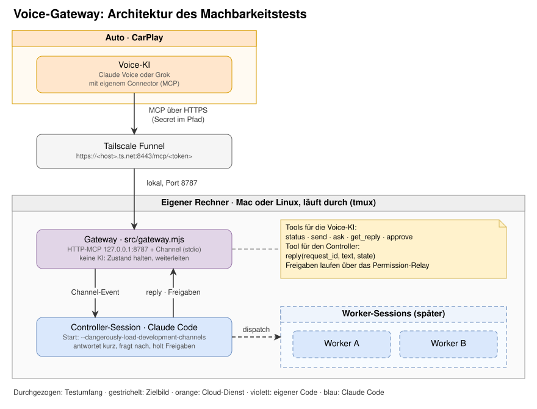
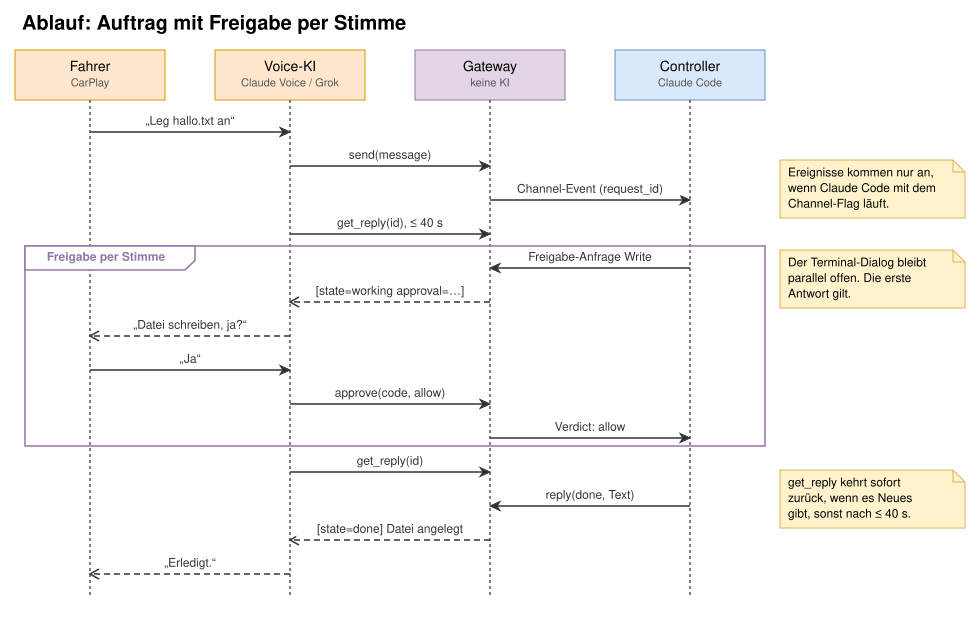
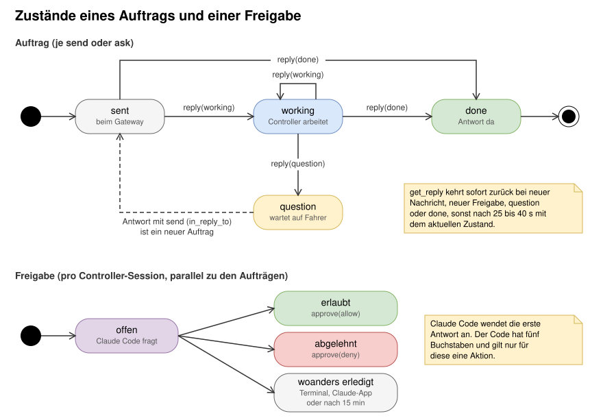

# cc-voice-gateway

Machbarkeitstest: Claude-Code-Sessions per Sprache aus dem Auto steuern. Eine Sprach-KI auf CarPlay
(Claude Voice oder Grok) ruft einen eigenen MCP-Connector auf. Dieser leitet die Anliegen an eine
laufende Claude-Code-Session weiter, die als Controller antwortet, nachfragt und Freigaben einholt.

Reines JavaScript (ESM), kein Build-Schritt. Einzige Abhängigkeiten: `@modelcontextprotocol/sdk` und `zod`.

> **Status:** Testaufbau, kein Dauerbetrieb. Zustand liegt nur im Speicher, Claude-Code-Channels
> sind eine Research Preview.

## Was der Test klären soll

1. Ruft die Sprach-KI auf CarPlay einen eigenen MCP-Connector überhaupt auf? Das ist die Frage, an der
   alles hängt.
2. Hält sie bei Aufgaben über 60 Sekunden durch, indem sie wiederholt nachfragt (Polling)?
3. Funktionieren Rückfragen und Freigaben (Bash, Write, Edit) per Stimme?



## Wie es funktioniert

**Ein Prozess, zwei Seiten.** Claude Code startet `src/gateway.mjs` selbst, weil der Server in
`controller/.mcp.json` eingetragen ist, und spricht mit ihm über stdio. Das Gateway meldet die
Fähigkeit `claude/channel` an. Dadurch landet jede Sprachanfrage als
`<channel source="voice" request_id="…">Text</channel>` direkt in der laufenden Controller-Session.
Derselbe Prozess lauscht auf `127.0.0.1:8787` und bietet dort der Sprach-KI MCP-Tools an.
Tailscale Funnel macht diesen Port per HTTPS erreichbar, denn Claude und Grok rufen Connectors aus
ihrer eigenen Cloud auf.

**Wer denkt:** Das Gateway ist bewusst keine KI. Es hält Zustand und leitet weiter. Die
Controller-Session (Claude Code) versteht, antwortet, fasst zusammen und fragt nach. Die Sprach-KI
führt das Gespräch im Auto.

| Seite | Tool | Zweck |
|---|---|---|
| Sprach-KI | `status` | Erreichbarkeit, offene Aufträge und Freigaben |
| Sprach-KI | `send` | Auftrag übergeben, kehrt sofort mit `id` zurück |
| Sprach-KI | `ask` | Auftrag übergeben und bis 40 s auf die Antwort warten |
| Sprach-KI | `get_reply` | Neues zu einer `id` abholen, wartet bis 40 s |
| Sprach-KI | `approve` | Freigabe mit fünfstelligem Code erlauben oder ablehnen |
| Controller | `reply` | Antwort mit `state` `working`, `question` oder `done` |



**Warum Polling:** Ein einzelner Toolaufruf darf nicht lange blockieren. MCP-Clients brechen
Anfragen häufig nach 60 Sekunden ab ([talk-to-claude-code][t2cc]). `get_reply` wartet darum höchstens
40 Sekunden und kehrt sofort zurück, sobald es Neues gibt. Die erste Zeile jeder Antwort ist
maschinenlesbar, etwa `[state=working id=k7f3 elapsed=34s]`, damit die Sprach-KI weiss, ob sie
weiter nachfragen muss.

**Freigaben:** Weil das Gateway zusätzlich `claude/channel/permission` anmeldet, schickt Claude Code
jede Freigabe-Anfrage parallel zum Terminal-Dialog an den Channel. Die erste Antwort gilt, egal ob
sie aus dem Auto oder aus dem Terminal kommt ([Channels-Referenz][ref]). Vertrauens- und
MCP-Consent-Dialoge laufen nicht darüber.

**Rückfragen:** Formulare (`AskUserQuestion`) kann im Auto niemand anklicken. Die
`controller/CLAUDE.md` verlangt deshalb Rückfragen als normalen Text mit `state: "question"`. Die
Antwort des Fahrers kommt als neuer Auftrag mit Verweis auf die ursprüngliche `id`.



## Voraussetzungen

- Node.js 20 oder neuer (getestet mit 22) und npm
- Claude Code mit claude.ai-Login, Channels ab v2.1.80. Bei Team- und Enterprise-Organisationen muss
  ein Admin Channels freischalten; Pro und Max brauchen das nicht ([Channels][channels]).
- Tailscale mit Funnel, alternativ ein anderer HTTPS-Tunnel
- Sprach-KI mit eigenem Connector: Claude-App (eigene Connectors nur in bezahlten Plänen) oder Grok
  ([grok.com/connectors][grok])

## Installation

```bash
tar xzf cc-voice-gateway.tar.gz   # oder: git clone <repo>
cd cc-voice-gateway
npm install
npm test          # 12 Tests, ohne Claude Code und ohne Auto
```

`npm test` startet das Gateway über stdio und spielt beide Enden: Claude Code (Channel-Events,
`reply`, Freigabe-Anfragen) und die Sprach-KI (HTTP-Tools).

## Testplan

Stufen der Reihe nach durchgehen. Jede Stufe prüft genau eine neue Strecke.

### Stufe 0: Schreibtisch, ohne Tunnel

```bash
scripts/start-controller.sh        # Terminal 1: Controller mit Channel
node scripts/fake-voice.mjs        # Terminal 2: spielt die Sprach-KI
```

Beim ersten Start fragt Claude Code im Terminal nach: Vertrauen für den Ordner, Warnung zum
Development-Channel und Zustimmung zum neuen MCP-Server aus `.mcp.json`. Alles bestätigen; die
Erlaubnis für `mcp__voice__reply` aus `controller/.claude/settings.json` gilt erst nach dem
Vertrauen in den Ordner. Die Session im normalen Modus mit
Rückfragen laufen lassen, nicht im Auto-Modus, sonst entscheidet ein Klassifikator statt dir und es
gibt keine Freigabe weiterzuleiten.

Im zweiten Terminal:

```text
> status
> ask Wie viele Dateien liegen im playground?
> send Leg im playground die Datei hallo.txt mit dem Text Grüezi an
  … [state=working … approval=abcde] Freigabe nötig (code=abcde): Write …
> allow abcde
> follow
```

Das Protokoll steht in `.logs/gateway.log`.

### Stufe 1: Tunnel

```bash
scripts/funnel.sh start            # gibt die Connector-URL aus
node scripts/fake-voice.mjs "https://<host>.ts.net:8443/mcp/<token>"
```

Am besten von einem anderen Netz aus prüfen, zum Beispiel über den Hotspot des Handys.

### Stufe 2: Connector im Text-Chat

Connector mit der URL aus Stufe 1 anlegen, **ohne Authentifizierung**, denn das Secret steckt im Pfad:

- **Claude:** Customize → Connectors → eigenen Connector hinzufügen. Die Bezeichnungen variieren je
  nach App-Version.
- **Grok:** grok.com/connectors → New Connector → Custom ([xAI-Doku][grok]).

Im Text-Chat am Handy: „Frag Claude Code nach dem Gateway-Status.“

### Stufe 3: Voice-Modus am Handy, stehend

Gleiche Frage im Voice-Modus. **Das ist der entscheidende Test.** Ruft die Sprach-KI hier das Tool
nicht auf, ist diese App für das Auto ungeeignet, egal wie der Server aufgebaut ist.

### Stufe 4: CarPlay, parkiert

1. „Frag Claude Code nach dem Status.“
2. „Frag Claude Code, wie viele Dateien im playground liegen.“
3. Lange Aufgabe mit Freigabe: „Sag Claude Code, es soll 90 Sekunden warten und dann im playground
   die Datei fertig.txt anlegen.“ Erwartet: Zwischenstände über gut 90 Sekunden und eine
   Freigabe-Frage, je nach Vorgehen von Claude Code am Anfang oder am Ende, dann „fertig“.
4. Rückfrage: „Sag Claude Code, es soll das playground aufräumen und vorher fragen, was weg darf.“

### Ergebnisse

| Prüfpunkt | Claude Voice | Grok |
|---|---|---|
| Tool im Text-Chat aufgerufen | | |
| Tool im Voice-Modus am Handy aufgerufen | | |
| Tool auf CarPlay aufgerufen | | |
| Polling über 60 s ohne Abbruch | | |
| Freigabe per Stimme | | |
| Rückfrage beantwortet | | |
| Antworten kurz und brauchbar vorgelesen | | |

## Sicherheit

- **Wer die URL kennt, lässt Claude Code auf deinem Rechner arbeiten.** Das gilt auch für eine
  Sprach-KI, die per Prompt-Injection manipuliert wurde. URL geheim halten, Tunnel nach dem Test
  schliessen (`scripts/funnel.sh stop`).
- Neues Secret: `.secrets/token` löschen, Controller neu starten, Connector-URL anpassen.
- Das Gateway bindet nur an `127.0.0.1`. Anfragen ohne gültiges Secret erhalten ein nacktes 404, damit
  Clients keinen OAuth-Ablauf starten.
- Freigabe per Stimme bedeutet: Wer `approve` aufrufen kann, kann Tools freigeben. Die Sprach-KI wird
  angewiesen, nur nach ausdrücklichem Ja freizugeben; das ist eine Anweisung, keine Durchsetzung.
  Abschalten mit `VOICE_GW_PERMISSION_RELAY=0`.
- Claude Code maskiert erkennbare Zugangsdaten in weitergeleiteten Freigabe-Texten, aber nicht jedes
  Geheimnis ([Channels-Referenz][ref]).
- Nicht mit `--dangerously-skip-permissions` starten und nur im Testordner `controller/` arbeiten.

## Konfiguration

Claude Code startet das Gateway. Umgebungsvariablen gehören deshalb in `controller/.mcp.json`:

```json
{
  "mcpServers": {
    "voice": {
      "command": "node",
      "args": ["../src/gateway.mjs"],
      "env": { "VOICE_GW_PORT": "8790" }
    }
  }
}
```

| Variable | Standard | Bedeutung |
|---|---|---|
| `VOICE_GW_PORT` | `8787` | lokaler HTTP-Port |
| `VOICE_GW_HOST` | `127.0.0.1` | Bind-Adresse, nur ändern, wenn du weisst warum |
| `VOICE_GW_TOKEN` | – | Secret direkt setzen, sonst `.secrets/token` |
| `VOICE_GW_TOKEN_FILE` | `.secrets/token` | Ort der Secret-Datei |
| `VOICE_GW_PERMISSION_RELAY` | an | `0` schaltet Freigaben per Stimme ab |
| `VOICE_GW_DEFAULT_WAIT` | `25` | Wartezeit von `get_reply` in Sekunden |
| `VOICE_GW_MAX_WAIT` | `40` | Obergrenze für `get_reply` und `ask` |
| `VOICE_GW_HINT_AFTER` | `20` | ab wann ein Diagnosehinweis kommt |
| `VOICE_GW_PERMISSION_TTL` | `900` | offene Freigaben verfallen nach Sekunden |
| `VOICE_GW_LOG_FILE` | `.logs/gateway.log` | leer setzen für nur stderr |
| `FUNNEL_PORT` | `8443` | für `scripts/funnel.sh`, erlaubt sind 443, 8443, 10000 |

## Fehlersuche

| Symptom | Ursache und Abhilfe |
|---|---|
| `status` meldet `controller=unconfirmed`, `get_reply` gibt einen Hinweis | Session ohne `--dangerously-load-development-channels server:voice` gestartet, oder die Organisation blockiert Channels. In der Session `/mcp` prüfen; Claude Code verwirft Ereignisse sonst stillschweigend. |
| Connector verlangt OAuth | URL ohne Secret im Pfad. Es muss `…/mcp/<token>` sein. |
| `EADDRINUSE` im Log | Eine zweite Controller-Session läuft im selben Ordner. Nur eine starten. |
| Sprach-KI antwortet selbst statt zu fragen | Ausdrücklich „frag Claude Code …“ sagen. |
| Sprach-KI hört nach dem ersten `working` auf | Bekanntes Risiko mancher Clients. Genau das prüft Stufe 4. |
| Keine Freigabe im Auto | Session im Auto-Modus, oder es ist ein Vertrauens- bzw. Consent-Dialog, die nicht weitergeleitet werden. |

Das Debug-Log von Claude Code liegt unter `~/.claude/debug/<session-id>.txt`.

## Aufbau

```text
src/
  gateway.mjs        Einstieg: verbindet beide Seiten, beendet sich mit der Session
  channel.mjs        stdio-Seite: Channel, reply-Tool, Permission-Relay
  voice.mjs          HTTP-Seite: MCP-Tools für die Sprach-KI, Secret-Prüfung
  store.mjs          Aufträge, Freigaben, Warten auf Änderungen
  config.mjs         Umgebungsvariablen, Secret
  log.mjs            Log nach stderr und Datei, nie nach stdout
controller/
  .mcp.json          startet das Gateway als Server "voice"
  .claude/settings.json   erlaubt mcp__voice__reply ohne Rückfrage
  CLAUDE.md          Regeln für die Controller-Session
  playground/        Arbeitsordner für Testaufträge
scripts/
  start-controller.sh   Controller mit Development-Channel starten
  funnel.sh          Tailscale Funnel starten, stoppen, URL ausgeben
  fake-voice.mjs     Sprach-KI am Schreibtisch nachspielen
  token.mjs          Secret anzeigen oder erzeugen
test/e2e.test.mjs    Ende-zu-Ende-Test ohne Claude Code
docs/*.drawio.svg    Diagramme: in GitHub als Bild, in draw.io bearbeitbar
```

## Grenzen und nächste Schritte

- Nur eine Controller-Session, noch keine Worker. Nächster Schritt: pro Worker ein eigener kleiner
  Channel mit eigenem Port, dazu Controller-Tools wie `list_workers`, `dispatch` und `worker_status`.
- Ist der Controller beschäftigt, kommen neue Ereignisse gesammelt im nächsten Turn an. Für echte
  Parallelität braucht es getrennte Sessions ([Channels-Referenz][ref]).
- Zustand nur im Speicher; ein Neustart vergisst offene Aufträge.
- Eigene Channels laufen während der Research Preview nur mit dem Development-Flag. Flag-Syntax und
  Protokoll können sich ändern ([Channels][channels]).

## Quellen

- [Claude Code: Channels][channels]
- [Claude Code: Channels-Referenz][ref]
- [Claude Code: Berechtigungen, Regeln für MCP-Tools][perm]
- [Tailscale: `tailscale funnel`][funnel]
- [xAI: Grok Connectors][grok]
- [Claude: Voice-Modus mit verbundenen Tools][voice]
- [talk-to-claude-code][t2cc]: Vorbild für Polling, Secret im Pfad und Voice-Tauglichkeit der Tool-Antworten

[channels]: https://code.claude.com/docs/en/channels
[ref]: https://code.claude.com/docs/en/channels-reference
[perm]: https://code.claude.com/docs/en/permissions
[funnel]: https://tailscale.com/docs/reference/tailscale-cli/funnel
[grok]: https://docs.x.ai/grok/connectors
[voice]: https://support.claude.com/en/articles/11101966-use-voice-mode
[t2cc]: https://github.com/osaighi/talk-to-claude-code
