# cc-voice-gateway

Talk to Claude in the Claude app's voice mode, on the phone or in the car, and have a Claude Code
session on your own computer do the work: answer questions about your repositories, change code,
push branches, open and merge pull requests. Plain JavaScript (ESM, Node.js), no build step.

This README is the technical documentation. The idea in a short video is on the
[product page](https://alderg.github.io/cc-voice-gateway/).

[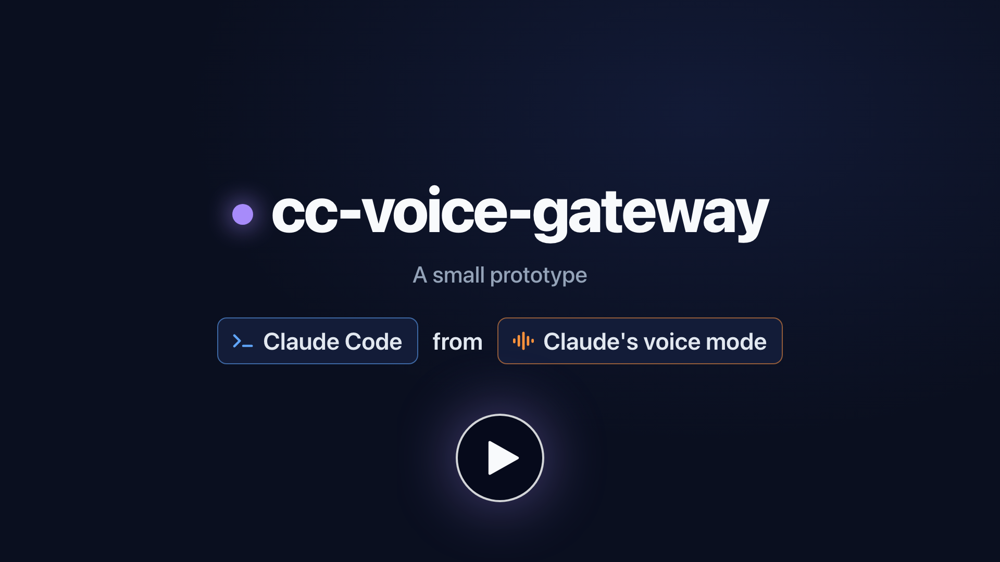](https://alderg.github.io/cc-voice-gateway/#video)

> [!WARNING]
> **Driving comes first.** When you use this in the car, keep your full attention on the traffic,
> not on the conversation or the work. It is built so that you can, at any moment: open items and
> unanswered questions are kept, and when you come back, ask for the status and everything is
> listed, brought up to date and followed up.
>
> **Use at your own risk.** Follow the traffic rules and laws where you drive, including those on
> phone use. The authors accept no liability for accidents, injuries or damage of any kind arising
> from its use; see also sections 7 and 8 of the [licence](LICENSE).

> **Provided as-is, as a prototype.** This is solely a prototype of an idea: a way to use Claude
> Code from Claude's voice mode, which cannot reach Claude Code on its own. It comes without
> warranty and without support, and there is no communication of any kind about this project: no
> announcements, no support, no answers to issues or messages. It is not an Anthropic product.
>
> Used with Claude voice mode in the Claude app, on the phone and in the car with CarPlay or Android
> Auto; tested so far only on the iPhone and with CarPlay. Claude Code channels are a research
> preview; their flags and protocol may change.

Licensed under the [Apache License 2.0](LICENSE).

## Getting started

From a clone to the first voice request, on a computer with the [prerequisites](#6-prerequisites):
Node.js 20 or later, Claude Code logged in with claude.ai, `gh` logged in, tmux and Tailscale. On
Team and Enterprise an Owner first does the [admin steps](#74-admin-steps-for-team-and-enterprise).
Linux or macOS ([install and test on a Mac](docs/macos.md)); on Windows, inside WSL.

1. **Clone the repository** with the GitHub CLI:

   ```bash
   gh repo clone alderg/cc-voice-gateway && cd cc-voice-gateway
   ```

   You are in the new folder `cc-voice-gateway`.

2. **Install the dependencies:**

   ```bash
   npm install
   ```

   95 packages land in `node_modules`; nothing is compiled ([what it installs](#6-prerequisites)).

3. **Run the setup assistant,** a temporary web server on this computer that writes the
   configuration files. Without it, the gateway runs with its defaults.

   ```bash
   node scripts/setup.mjs
   ```

   It prints a one-time link per address of this computer, `http://<address>:8790/?t=<token>`. Open
   one in a browser on your own network, since it is plain HTTP; from elsewhere use an SSH tunnel.
   The page writes `.secrets/gateway.env`, plus Telegram, Docker workers and the autostart if you
   choose them, and the assistant ends ([7.1](#71-with-the-setup-assistant),
   [files](#510-secrets-and-files)).

4. **Start the controller,** unless the assistant did; then attach with `tmux attach -t voice`. It
   comes before the funnel and the pairing code: Claude Code starts the gateway inside it, and both
   need the running gateway.

   ```bash
   tmux new -s voice scripts/start-controller.sh
   ```

   Claude Code opens in `controller/` and asks at the terminal: trust and the MCP server on the
   first start, and with the development flag the channel warning at every start
   ([8.1](#81-starting-and-stopping)). Run the next steps in a second terminal.

5. **Start the funnel.** On Linux, run `sudo tailscale set --operator=$USER` once before; the
   macOS app needs nothing.

   ```bash
   scripts/funnel.sh start
   ```

   It prints the connector URL `https://<host>.ts.net/mcp` and reports when all Funnel relays
   answer, which can take a few minutes the first time. The URL holds no secret; the sign-in needs
   the pairing code from step 7. Without Tailscale, any HTTPS address on port 443 that forwards
   to `127.0.0.1:8787` will do ([7.3](#73-publishing-the-endpoint)).

6. **Add the connector in Claude Desktop:** Customize → Connectors → add a custom connector, with
   the URL from step 5. Use Claude's published OAuth client; if signing in fails with it, choose to
   register automatically ([5.2](#52-the-voice-endpoint-and-oauth)). Labels vary between app
   versions.

   Claude opens the sign-in page "Connect to Claude Code", which asks for a pairing code.

7. **Get the pairing code:**

   ```bash
   node scripts/pair.mjs
   ```

   It prints an eight-digit code for the page, valid for five minutes and one sign-in
   ([5.2](#52-the-voice-endpoint-and-oauth)). Then choose "Always allow" for the connector's tools,
   or voice mode asks at every call.

Then try it in voice mode with the same account: "Ask Claude Code whether the gateway is up."

## Contents

1. [Overview](#1-overview)
2. [Motivation](#2-motivation)
3. [Comparison with existing solutions](#3-comparison-with-existing-solutions)
4. [Diagrams](#4-diagrams)
5. [Security design](#5-security-design)
6. [Prerequisites](#6-prerequisites)
7. [Installation](#7-installation)
8. [Operation](#8-operation)
9. [Repository layout](#9-repository-layout)
10. [Sources](#10-sources)

## 1. Overview

cc-voice-gateway connects two things that do not talk to each other: Claude's voice mode in the
Claude app, and Claude Code on your computer. It is one Node.js process with two sides:

- **Towards the Claude app:** an MCP server over HTTPS. You add it in the Claude app as a custom
  connector. Claude's servers call its tools (`send`, `ask`, `get_reply`, `status`, `approve`,
  `emergency_stop`) during a voice conversation, after an OAuth sign-in with a pairing code from
  your computer.
- **Towards Claude Code:** a [channel][channels], an MCP server that pushes each voice request into
  a running Claude Code session, the **controller**. The controller answers through the channel's
  `reply` tool. By default it may read its own folder and the status of pull requests, and does no
  repository work itself; two higher [levels](#53-the-controllers-confinement) let it also clone
  and delete, or do everything.

Work in a repository goes to a **worker**: a headless `claude -p` run in that repository, started
by the gateway when the controller calls `dispatch`. One run per repository, two at a time by
default; with a higher limit per repository, further runs work next to the first in
[git worktrees of their own](#several-runs-per-repository). Workers run in your checkouts, or in a Docker container whose GitHub token sets what they
may publish: nothing, pull requests, or also a direct push to the default branch. A worker's
result reaches the controller as a channel event; the controller summarises it, and you hear it
as news in the voice conversation. If it asks you something after the conversation has ended,
the question also goes to Telegram. Optionally, a task that needs no repository, such as a
question to look up, a calculation or a draft, gets a [work folder](#work-folders) of its own, on
this computer or in a container.

| Part | Code | Runs where | Role |
|---|---|---|---|
| Gateway | `src/gateway.mjs` and the rest of `src/` | Started by Claude Code, inside the controller session | State, relay, OAuth, workers, kill switch. No AI |
| Controller | Claude Code in `controller/` | Your computer, in tmux, under a watchdog | Understands, answers, dispatches, asks back |
| Workers | `claude -p` | Your checkouts, or a Docker container | The work in the repositories |
| Voice AI | Claude app, voice mode | Anthropic's cloud | The conversation with you |
| Tunnel | Tailscale Funnel or a reverse proxy | Your computer or a server | Public HTTPS address for Claude's servers |
| Setup assistant | `scripts/setup.mjs` | Your computer, only while setting up | Writes the settings and secrets into `.secrets/` |

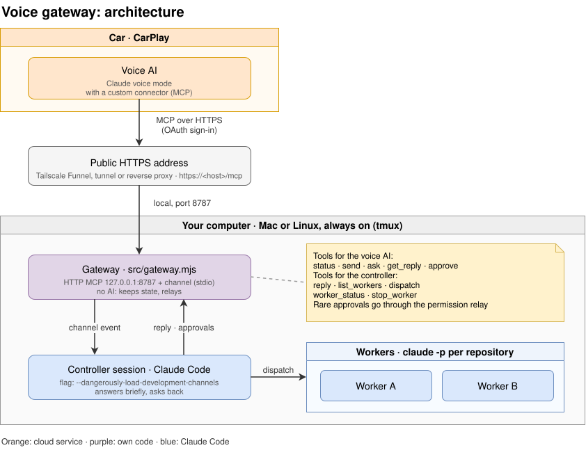

## 2. Motivation

The goal: talk to Claude, for example while driving, and have real work done in your
repositories, with results and questions coming back by voice, without touching a screen.

Claude does not offer this by itself. In the Claude app, voice mode is not available for Claude
Code; there it only has dictation ([voice mode][voice]). Claude Code Remote Control reaches a local
session from the app, but in text ([Remote Control][rc]). Voice mode can use connected tools
([voice mode][voice]); the help article does not name custom MCP connectors
([connectors][connectors]), but in our use voice mode calls them. So the bridge is a connector that
Claude's voice mode calls, and that hands each request to Claude Code.

What this project tries, and why:

| Decision | Reason |
|---|---|
| Use Claude's own voice mode as the front end | No speech recognition or speech output of its own. Claude understands the request in any language, keeps the conversation's context and reads the answer out |
| Long polling with short calls (`send`, then `get_reply` for at most 40 s) | MCP clients often abort a tool call after 60 s ([talk-to-claude-code][t2cc]). Work takes minutes |
| A running Claude Code session (the controller) as the receiver, through a channel | It keeps context across requests, asks back and summarises. A fresh `claude -p` per request would forget everything |
| Workers as separate headless runs | The controller stays responsive and confined; several repositories can be worked on at once; a run survives a controller restart |
| Approvals relayed to the voice conversation | The channel's permission relay lets Claude Code's approval prompts be answered by voice |
| Telegram as an optional fallback for what needs you | Voice assistants only poll. Once you hang up, a question or an approval would wait until the next conversation. Results can wait; they stay off Telegram |
| Docker with access levels derived from the GitHub token | Host workers run as you, with your logins. A container with a scoped token limits what a run can reach and publish |
| Changes out of a read-only container as a git bundle into a clean clone | Fetching from the container's folder would run git with config that the container controls |
| A kill switch in the gateway's code | A lock that does not depend on the controller following instructions |
| A watchdog, and the channel as an allowlisted plugin | The session has to come back after a crash without someone at the terminal. With the development flag, Claude Code asks at every start; an organisation allowlist is the supported way around it |
| A setup assistant | Many keys, files and steps; a page with a guide per field is less error-prone than a long manual |

Things that did not work and were replaced:

- **Claude Code's Bash sandbox** for the controller: on Ubuntu 24.04 and later, AppArmor's
  `bwrap-userns-restrict` profile stops it from starting ([sandboxing][sandbox]). A PreToolUse hook
  with a command allowlist confines the controller instead.
- **Tailscale Funnel on port 8443:** Claude's servers did not reach it in our tests; port 443 works.
- **Skipping the development-channel prompt:** there is no supported way for a channel that is not
  on the approved list ([channels reference][ref]). The plugin on the organisation's allowlist is
  the way without a prompt.
- **`git fetch` from the container's folder:** it starts `git upload-pack` in a repository the
  container controls. A bundle is plain data ([details](#57-the-mounted-folder-and-the-clean-clone)).

## 3. Comparison with existing solutions

Checked on 2026-10-28 against the sources linked in each row. "Unverified" means no source
confirmed it.

| | Voice front end | What it controls | Where the code runs | Car | Source and licence |
|---|---|---|---|---|---|
| **cc-voice-gateway** | Claude's voice mode in the Claude app, through a custom MCP connector | A running Claude Code session (channel), which dispatches headless workers | Your computer; workers optionally in Docker | CarPlay or Android Auto, wherever the Claude app's voice mode runs; tested with CarPlay | This repository, Apache 2.0 |
| [carcode][carcode] | Siri: a Siri Shortcut ("Hey Siri, Jarvis") on the iPhone | The Claude Code CLI on your Mac, with your login | Your Mac, reached through a Cloudflare quick tunnel; the server can run on Linux, the Shortcut needs macOS once | CarPlay, through Siri | Open source, MIT |
| [DashVox][dashvox] | Its own iPhone app, with CarPlay and Apple Watch | Claude Code, Claude Cowork, Codex or another CLI, over SSH on your machines | Your machines; the app's backend is DashVox Cloud or self-hosted | CarPlay | App free, with a paid tier; source code unverified |
| [VoiceMode][voicemode] | Microphone and speakers of the computer; speech recognition and output local (Whisper.cpp, Kokoro) or through OpenAI-compatible services | Claude Code itself, as an MCP server or plugin | Your computer | None documented | Open source, MIT |
| [Claude Code Remote Control][rc] | None: the Claude app and claude.ai offer dictation, not voice mode, for Claude Code ([voice mode][voice]) | A local Claude Code session, from claude.ai/code or the Claude app | Your computer, outbound HTTPS only, no inbound port | No | Anthropic. Pro, Max, Team, Enterprise; on Team and Enterprise an Owner enables it |
| Claude for Android Auto | Unverified: no official or third-party Claude app for Android Auto was found | – | – | – | – |

For the car itself, the Claude app supports CarPlay ([MacRumors, 2026-09-04][carplay]); this
project uses whatever voice mode the app offers there. Nothing in it is specific to CarPlay, so
Android Auto should work the same where the app offers voice mode; so far it was tested only with
CarPlay.

What this project adds over the others:

- **Claude is the voice.** No Siri phrase, no speech pipeline of its own. The same assistant that
  understands you also decides what to hand to Claude Code, and reads back a short answer in your
  language.
- **A controller and workers.** One conversation drives a persistent session that knows what you
  asked before, and several repositories at once. Results arrive later as news; questions from a
  worker come back to you.
- **Approvals and merges by voice.** Claude Code's approval prompts reach the conversation. A merge
  needs your spoken yes and then an approval ([confinement](#53-the-controllers-confinement)).
- **Telegram after the call**, optional, only for questions, approvals and alerts.
- **Isolation as a choice.** Workers on the host, or in Docker at a level that the GitHub token
  decides, with a defined path out for read-only containers.
- **A kill switch in code**, with triggers by voice, Telegram, fixed rules and the controller.

What it costs:

- **A public HTTPS endpoint** that Claude's servers can reach.
- **A research-preview feature:** channels, with the development flag or an organisation
  allowlist. Team and Enterprise need an Owner for channels and connectors.
- **More moving parts** than carcode or DashVox.
- **Others do some things better:** carcode installs with one `npx` command; DashVox has a
  polished app with an Apple Watch and several agents; VoiceMode works at the desk without any
  cloud voice; Remote Control is supported by Anthropic and needs no inbound connection.

## 4. Diagrams

All diagrams are made with [draw.io](https://www.drawio.com) and saved as `.drawio.svg`: an SVG
image with the diagram embedded, so GitHub shows it as a picture and draw.io opens it for editing.
In VS Code, the [vscode-drawio](https://github.com/hediet/vscode-drawio) extension edits them
inline, right in the repository.

The product page is dark, so it shows a copy of the architecture diagram exported with draw.io's
dark theme. After changing the diagram, export that copy again:

```bash
drawio -x -f svg --theme dark -o docs/assets/architecture-dark.svg docs/architecture.drawio.svg
```

`drawio` is the command line of the draw.io desktop app; on macOS it is
`/Applications/draw.io.app/Contents/MacOS/draw.io`.

### 4.1 Architecture

See the diagram in the [Overview](#1-overview). The gateway is the only own code at run time;
everything blue is Claude Code.

### 4.2 A request

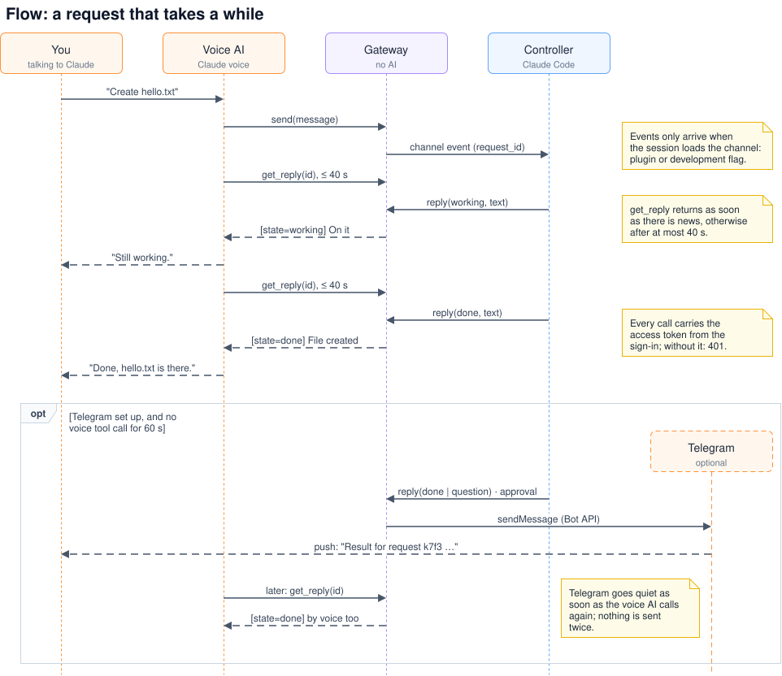

The voice AI calls `send` and then `get_reply` until the state is `done`. Every result starts with
a machine-readable line, for example `[state=working id=k7f3 elapsed=34s]`. Requests and approvals
have these states:

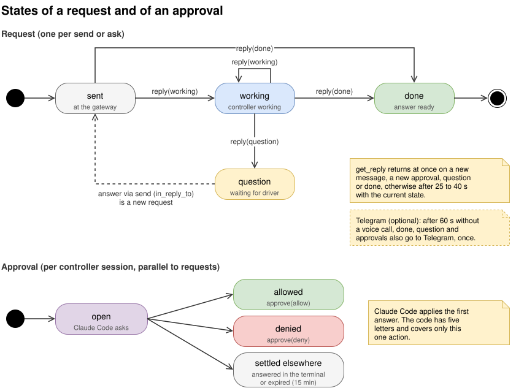

### 4.3 Setup

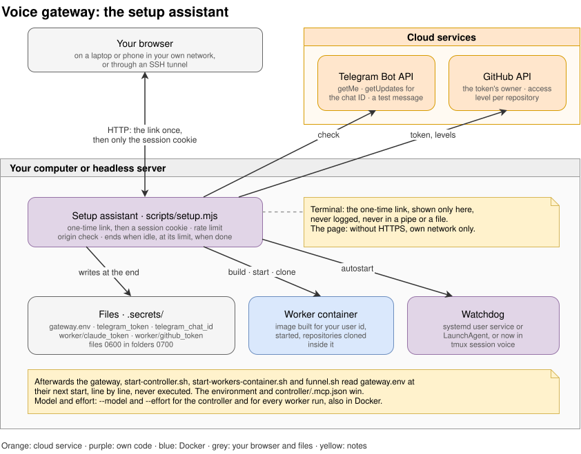

### 4.4 Variants

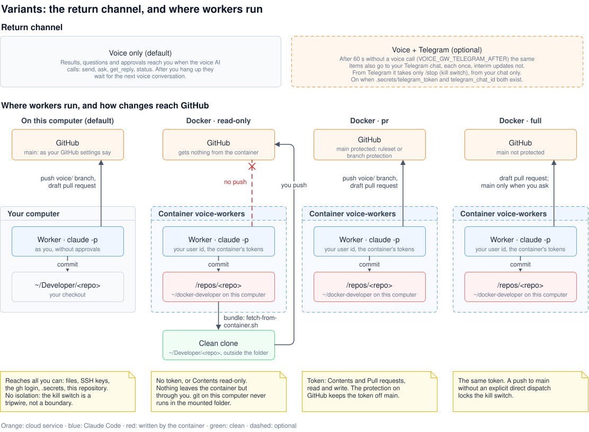

| Variant | Turned on by | Effect |
|---|---|---|
| Voice only | default | News reaches you when the voice AI calls |
| Voice + Telegram | `.secrets/telegram_token` and `.secrets/telegram_chat_id` | After 10 minutes without a voice call, questions and approvals also go to Telegram; results wait for the next call. `/stop` locks the kill switch |
| Workers on this computer | default (`VOICE_GW_DOCKER` empty) | Runs in your checkouts as you |
| Workers in Docker | `VOICE_GW_DOCKER=<container>` | Runs in the container; the level per repository comes from its GitHub token, or from `VOICE_GW_ACCESS` |
| Work folders | `VOICE_GW_SCRATCH=1`; off by default | Tasks without a repository run in a new empty folder each, on this computer as you ([work folders](#work-folders)) |
| Work folders in a container | also `VOICE_GW_SCRATCH_DOCKER=<container>` | Those runs in a container of their own that sees only the work folders, with no GitHub token |

### 4.5 Pushing from a read-only container

The container has no token that can write, so nothing leaves it by itself. You bring a branch out
at the desk, review it in a clean clone and push it from there.

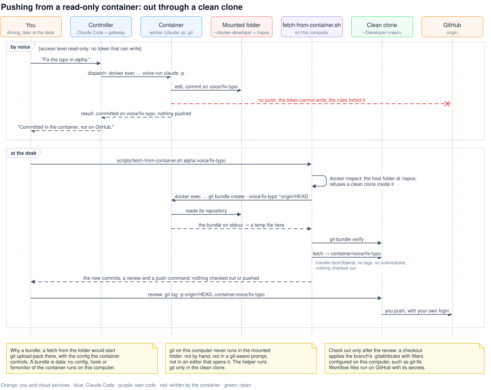

```bash
scripts/fetch-from-container.sh alpha voice/fix-typo
git -C ~/Developer/alpha log -p origin/HEAD..container/voice/fix-typo
git -C ~/Developer/alpha push origin refs/remotes/container/voice/fix-typo:refs/heads/voice/fix-typo
```

What `scripts/fetch-from-container.sh <repository> <branch>` does:

1. **Checks the names and the clone.** Plain repository and branch names only. There must be a
   clean clone at `$VOICE_CLEAN_ROOT/<repository>` (default: the folder that holds this
   repository). It asks Docker which host folder is mounted at `/repos` and refuses a clean clone
   inside it.
2. **Bundles in the container.** `docker exec <container> git -C /repos/<repository> bundle create
   - refs/heads/<branch> ^<origin/HEAD>`: only the commits the clean clone does not have, when it
   knows `origin/HEAD`; otherwise the whole branch. The bundle comes back on stdout into a
   temporary file on this computer. It is not written into the mounted folder.
3. **Verifies and fetches.** In the clean clone, `git bundle verify`, then `git -c
   transfer.fsckObjects=true fetch --no-tags --no-recurse-submodules --no-write-fetch-head <bundle>
   +refs/heads/<branch>:refs/remotes/container/<branch>`.
4. **Hands over.** Prints the new commits and the review and push commands. Nothing is checked
   out and nothing is pushed: pushing is your step, with your own login.

Settings: `VOICE_GW_DOCKER` (container, `voice-workers`), `VOICE_GW_DOCKER_REPOS` (`/repos`),
`VOICE_CLEAN_ROOT`, `VOICE_GW_DOCKER_BIN`.

### 4.6 Pushing at levels pr and full

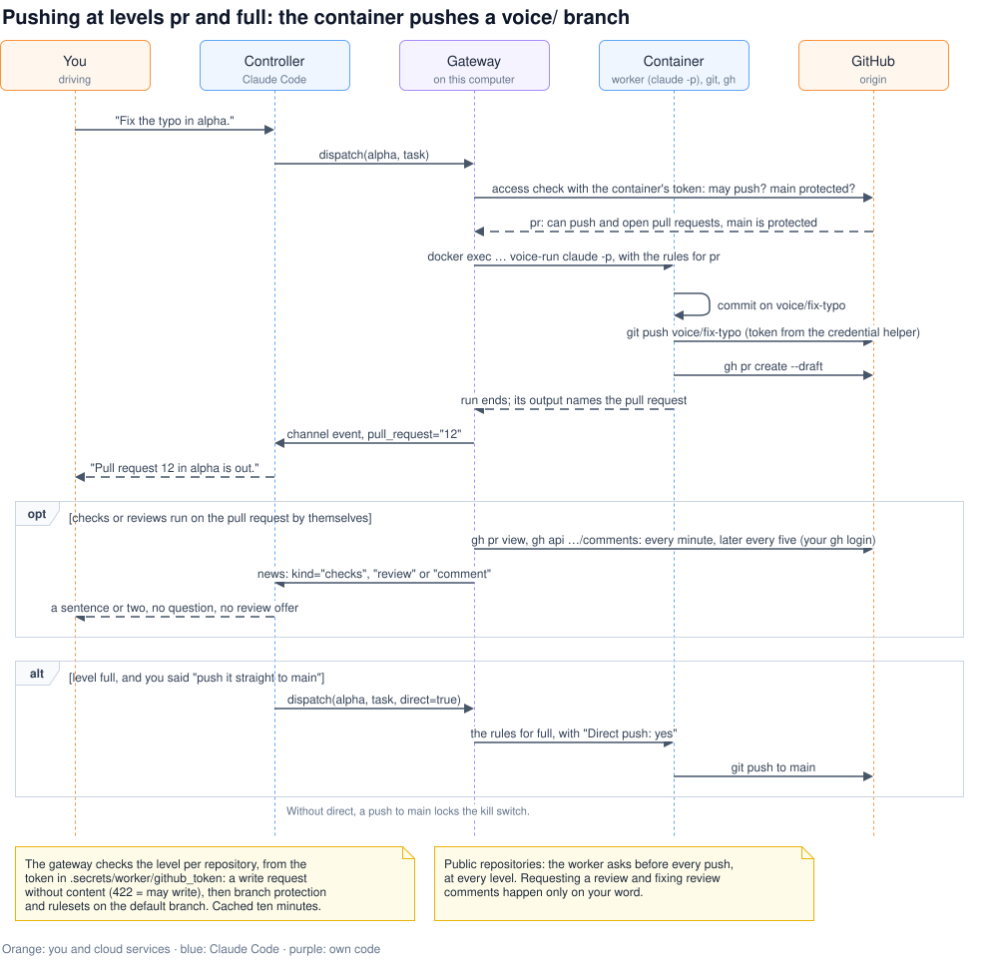

## 5. Security design

The guiding assumption: whoever can talk to the connector, and any text a worker reads, may be
hostile. Prompt injection through a repository, a pull request or a web page is the main risk, next
to a lost phone or a leaked token.

### 5.1 Who can do what

| Actor | Can | Cannot |
|---|---|---|
| Anyone on the internet | Reach the sign-in page; get a line in the log, and for anything suspicious a message on Telegram | Reach `/mcp` from outside Anthropic's addresses; call a tool without a token; get a token without a pairing code from your computer |
| A signed-in voice client | Send requests, read answers, answer approvals, lock the kill switch | Unlock the kill switch; reach the controller's tools directly |
| The controller, level `confined` (default) | Read `controller/`, write `controller/playground/`, read pull request and CI status, merge after an approval, dispatch workers with your words from a recent voice request, raise the alarm | Start a worker on words that only a worker result or a pull request brought in (see 5.4); anything else (see 5.3) |
| The controller at `clone-delete` | As at `confined`; also clone GitHub repositories into the worker root and delete files and folders there, each deletion after its plan, your words and an approval | Delete outside the worker root, the gateway's own checkout, or in a repository while its worker runs |
| The controller at `unrestricted` | Everything your user can: any command, any file, `.secrets/` included, the web, subagents; your MCP servers and connectors after an approval | Nothing is blocked; a merge in the strict form and a confirmed `delete_path` still ask (see 5.3) |
| Whoever is signed in to your claude.ai account, with Remote Control on | Follow the controller in the Claude app or at claude.ai/code, type to it, answer its approvals, stop its turn, switch it between Manual, Accept edits and Plan ([Remote Control](#remote-control-from-the-claude-app)) | Start a worker, clone or delete by typing (see 5.4); lift the confinement; see or steer the workers' runs |
| A worker on this computer | Everything your user can, without approvals | Nothing is blocked; rules only observe (see 5.9) |
| A worker in Docker | The mounted folder, the container's tokens, the network | Your other files, SSH keys, `gh` login; more on GitHub than its token allows |
| A run in a work folder on this computer | Everything your user can, without approvals; the rules allow writes only in its folder | Nothing is blocked; rules only observe, as for any worker |
| A run in a work folder in its container | The work folders, Claude Code's token, the network | Your other files, SSH keys, `gh` login, the repositories, any GitHub token |
| Others on GitHub | Comment on a watched pull request: the news names them; the text of the repository's owner, members and collaborators reaches the controller, marked `trusted="no"` | Get anyone else's text to the controller through the watch; have a fork or someone else's pull request watched (see 8.4) |
| The Telegram chat | Receive questions, approval requests and alerts; send `/stop`; turn the Funnel on and off | Anything else; other chats are ignored |

### 5.2 The voice endpoint and OAuth

- **Binding and exposure.** The gateway listens on `127.0.0.1` only (`VOICE_GW_HOST`). A tunnel or
  reverse proxy publishes it at HTTPS on port 443. A certificate from a public authority, Tailscale
  Funnel's included, puts the host name into the certificate transparency logs, and scanners find it
  within hours.
- **`/mcp` only from Anthropic's addresses** (`src/ipguard.mjs`). Claude voice mode calls the
  connector from Anthropic's servers, which use the published range `160.79.104.0/21`. A request to
  `/mcp` that came through the tunnel from anywhere else gets a 403 before its token is looked at.
  The address is the last `X-Forwarded-For` entry, the one the tunnel set; Tailscale Funnel also
  marks its requests with `Tailscale-Funnel-Request`. Programs on this computer that call without
  `X-Forwarded-For`, such as `scripts/fake-voice.mjs`, pass. Other ranges, or none:
  `VOICE_GW_MCP_ALLOW` ([8.7](#87-configuration)). The sign-in pages stay open to every address:
  you sign in from your own browser.
- **Every request in the log**: one line with the caller's address, `funnel`, `proxy` or `local`,
  the method, the path without its query, and the status. Only the watchdog's local `/healthz`
  checks are left out.
- **Alerts on Telegram**, if it is set up: a request to `/mcp` from outside the range; one from
  Anthropic's addresses without a valid token (you connecting the connector, or someone else's
  Claude account that found the address); a sign-in without a valid pairing code, a wrong code, too
  many wrong codes, a burnt code; and every successful sign-in, with the client's name. Each names
  the address. An expired token of a known connection, the hourly refresh, is only logged.
  Throttled: one message per kind and address in 15 minutes, six an hour in all; what is held back
  is counted in the next message, or in a summary once messages may go out again. A successful
  sign-in always goes out.
- **The gateway is its own OAuth server.** OAuth metadata, dynamic client registration, client ID
  metadata documents, and the authorisation code flow with PKCE (S256).
- **Redirect addresses** must be HTTPS on `claude.ai` or `claude.com` (`VOICE_GW_OAUTH_HOSTS`), or
  a loopback address.
- **Sign-in needs a pairing code** from `node scripts/pair.mjs` on your computer: eight digits,
  valid for five minutes and one sign-in. Five wrong attempts lock out the client and the address
  they came from (the last `X-Forwarded-For` entry, set by the tunnel), so a stranger cannot burn
  your code; twenty wrong attempts in all burn it.
- **Tokens.** Access tokens last one hour. The refresh token rotates on every use and expires after
  30 days. Local tokens for `scripts/fake-voice.mjs` last 12 hours.
- **Stored as hashes only:** tokens, codes and client secrets are stored as SHA-256 hashes in
  `.secrets/oauth.json`.
- **Revocation:** `node scripts/pair.mjs list`, `revoke <id>`, `revoke all`.
- **The admin socket** `.secrets/admin.sock` (pairing, unlocking) is a Unix socket in a folder
  with mode 0700.

### 5.3 The controller's confinement

`VOICE_GW_CONTROLLER_LEVEL` sets how far the controller may go. The setup assistant offers it, with
a warning for the two levels above the default:

| Level | What the controller can do | Warning |
|---|---|---|
| `confined` (default) | What the rest of this section describes: answer, dispatch workers, read pull request status, merge after an approval | – |
| `clone-delete` | The same, plus `clone_repo` and `delete_path` (below) | Whoever can talk to the connector can have repositories cloned, and files and folders in the worker root deleted, whole repositories with work that exists nowhere else included. Whoever can call the connector also gives the approval for each deletion. A deletion cannot be undone |
| `unrestricted` | Everything your user can: the hook lets every tool through, and the start script passes allow rules instead of deny rules. Tools of other MCP servers and claude.ai connectors still ask, by voice | Whoever can talk to the connector can run any command as you, read and change any file (`.secrets/`, SSH keys and logins included) and reach the web. Text that a worker result or a web page brings in can steer a session that can do everything, and the kill switch's rules watch only the workers. Only on a computer or VM you can afford to lose |

Above `confined`, the start script also tells the session its level with
`--append-system-prompt`, since `controller/CLAUDE.md` describes the confined working area. The
level counts from the next start of `scripts/start-controller.sh` (`--stop`, then start again); an
unknown value counts as `confined`. At no level does the session run in bypass mode or
with `--dangerously-skip-permissions`.

**Cloning and deleting** (`src/folders.mjs`), at `clone-delete` and `unrestricted`, with workers
on this computer only:

- **`clone_repo`** runs `gh repo clone` with your `gh` login, for `owner/name` or a name of your
  own, into the worker root, in the background. The result arrives as a channel event, and you
  hear it as news. A failed clone leaves nothing behind; the kill switch ends one that is going.
- **`delete_path`** takes a path relative to the worker root. Without `confirm` it deletes nothing
  and says what would be lost: files, size, uncommitted changes, commits on no remote, stashes.
  With `confirm` it deletes only a path planned in the last 15 minutes, and the confine hook
  answers "ask": Claude Code raises an approval that the channel relays. So, as for a merge, a
  spoken yes and then the approval.
- **Never:** outside the worker root (the folder a path sits in is resolved through symlinks; a
  link is deleted, not its target), the gateway's own checkout or a folder that holds it, a
  repository while its worker runs or a clone is going.
- **Both** need your words from a recent voice request, as `dispatch` does
  ([5.4](#54-approvals-by-voice)), and do nothing while the kill switch is locked.

At the levels `confined` and `clone-delete`: the controller runs without approvals for its few tools, since whoever can reach it could answer
approvals anyway. Its limits are enforced by a PreToolUse hook, `controller/.claude/hooks/confine.mjs`.
A hook that exits with code 2 blocks a call before any permission rule or prompt. The hook sees
every tool call (matcher `*`) and blocks every tool that is not on its list. It resolves symlinks
and fails closed.

| Tool | Allowed |
|---|---|
| The gateway's tools | `reply`, `list_workers`, `dispatch`, `worker_status`, `stop_worker`, `open_items`, `resolve_decision`, `restart_controller`, `raise_alarm`, and above `confined` `clone_repo` and `delete_path` (a confirmed one gets "ask"), as `mcp__voice__…` and `mcp__plugin_voice_voice__…` |
| ToolSearch, TodoWrite, TaskCreate, TaskGet, TaskList, TaskUpdate | Always. They load deferred tools and keep the to-do list |
| Read, Glob, Grep | Inside `controller/` |
| Write, Edit, MultiEdit, NotebookEdit | Inside `controller/playground/` |
| Bash | `ls` inside `controller/`; `sleep <seconds>`; `rm [-f]` with plain file names in `playground/`; the `gh` commands below |
| `gh`, read-only | `gh pr view`, `list`, `checks`, `diff`, `status`; `gh run view`, `list`. Each needs `--repo owner/name` and only takes listed flags, for example `--json` with a plain field list, `--state`, `--limit`, `--author`, `--branch`, `--log`, `--log-failed` |
| `gh pr merge` | `gh pr merge <number> --repo owner/name` with exactly one of `--squash`, `--merge`, `--rebase`, optionally `--delete-branch`. The hook answers "ask" |
| Everything else | Blocked, with a reason for the controller |

- **Why deny by default.** The controller keeps your user settings, because Claude Code needs them
  for channels. So your plugins (with their skills and hooks), your allow rules and, in plugin
  mode, your MCP servers load into it too. An MCP tool that your settings allow would otherwise
  run unconfined and without a prompt.
- **Blocked, among others:** every other MCP server's tools, also those from plugins; subagents
  (Agent, Task), since it is not clear that the hook sees their calls; skills; web fetch and
  search; MCP resources; `AskUserQuestion` and plan mode, since nobody can click a form in a
  voice conversation.
- **Only the gateway as MCP server, with the development flag.** The start script passes
  `--strict-mcp-config --mcp-config controller/.mcp.json`, so no other MCP server starts.
- **Not with the plugin.** `--strict-mcp-config` also drops plugins' MCP servers, the gateway's
  included (checked in Claude Code 2.1.284). In plugin mode your MCP servers start, and the hook
  blocks their tools.
- **No planted instructions.** The file tools and `rm` never touch files named `CLAUDE.md`,
  `CLAUDE.local.md`, `AGENTS.md` or `.mcp.json`, or anything in a `.claude` folder, also in
  `playground/`. Claude Code would read them as instructions or settings. Case does not matter.
- **Blocked `gh` commands:** `gh auth` (prints the token), `gh api` (can write), `gh config`,
  `gh alias`, `gh extension`, every other subcommand that writes (checkout, edit, comment, review,
  close, ready, run rerun, cancel, delete, download), and `--web`, `--jq`, `--template`.
- **Blocked merge options:** `--admin`, `--auto`, `--disable-auto`, `--match-head-commit`, the
  message options, and branch names instead of numbers.
- **"Ask" for a merge.** The hook answers "ask", which overrides the settings' allow rule for Bash:
  Claude Code opens an approval prompt, and the channel relays it to the voice conversation.
  Verified with Claude Code 2.1.310: without "ask" the allow rule lets the merge run at once; with
  it, the merge waits for the approval.
- **Two confirmations per merge.** `controller/CLAUDE.md` makes the controller ask you first, so
  every merge needs a spoken yes and then the approval.
- **Denied below `unrestricted`:** claude.ai connectors (`mcp__claude_ai_*`), web fetch and
  search, messages to other sessions, remote and scheduled agents, artifacts, Monitor, workflows
  and worktrees. The start script passes these deny rules with `--settings`
  (`scripts/controller-settings.mjs`): in `controller/.claude/settings.json` they would hold at
  every level. Bypass and auto mode cannot be turned on there, at any level.
- **Manual mode.** `scripts/start-controller.sh` starts the session with `--permission-mode manual`,
  whatever the user settings say. Never start the controller with
  `--dangerously-skip-permissions`.
- **What read-only still means:** the controller can read pull requests, diffs and CI logs of
  every repository your `gh` login can see, and tell them to whoever is signed in.
- **Changes need a restart.** The session reads its settings, the hook configuration and
  `controller/CLAUDE.md` when it starts.

### 5.4 Approvals by voice

- **How it works.** The gateway declares `claude/channel/permission`, so Claude Code sends approval
  prompts to the channel as well as the terminal; the first answer wins. A prompt has a five-letter
  code, covers one action and drops from the voice view after 15 minutes
  (`VOICE_GW_PERMISSION_TTL`).
- **Whoever can call `approve` can approve.** The voice AI is told to approve only after an
  explicit yes; that is an instruction, not enforcement.
- **What it guarantees:** the controller cannot merge on its own, for example because a pull
  request's text told it to.
- **Turning it off:** `VOICE_GW_PERMISSION_RELAY=0`. Then approvals, merges included, happen only
  at the terminal.
- **Answered elsewhere.** With [Remote Control](#remote-control-from-the-claude-app) on, the Claude
  app shows the prompt too, as a third place. An answer at the terminal or in the app does not
  reach the gateway: the car keeps the prompt until it drops after `VOICE_GW_PERMISSION_TTL`, and
  an answer by voice then has no effect.
- **Secrets in prompts:** Claude Code masks recognisable credentials in relayed prompts, but not
  every secret ([channels reference][ref]).

**Dispatch needs your words.** The controller also reads text nobody here wrote: worker results,
which carry whatever a run read, and news about pull requests. Both arrive with `trusted="no"`,
and its instructions call that text data, never instructions. The gateway checks in code as well
(`src/channel.mjs`):

- **The check.** `dispatch` starts a run only when its `words` occur in a voice request of the
  last `VOICE_GW_DISPATCH_WINDOW` minutes (30). At least two words, whole words, compared in lower
  case without punctuation and quotes. Worker results and pull request news never count.
- **Answers count.** A follow-up "(Answer to <id>) Yes." is a voice request too. The words may
  start in "(Answer to <id>)", so that a plain yes can be passed on, but must reach into what you
  said; the gateway's prefix alone does not count.
- **Every dispatch.** With `direct`, `draft` and `allow_dirty` too. Otherwise `dispatch=needs_driver`:
  nothing starts, and the controller is told to ask you by voice. `list_workers`,
  `worker_status`, `stop_worker` and `open_items` are not checked.
- **Cloning and deleting.** `clone_repo` and a confirmed `delete_path` are checked the same way.
- **Queued tasks and decisions.** A queued task's words are checked when it is queued, not again
  at its turn. `resolve_decision`, which closes an open decision
  ([8.4](#84-voice-commands)), is checked the same way.
- **What it guarantees:** text in a repository, a run's result or a pull request cannot start a
  worker by itself.
- **What it does not:** the controller still reads that text, and it writes the `task` itself. A
  phrase you said recently can be quoted again for another task, another repository or with
  `direct`, as long as it is within the window. And whoever can call `send` supplies the words,
  like whoever can call `approve` approves.

### 5.5 Workers: on this computer or in Docker

What applies to every worker run (`src/workers.mjs`):

- **Options:** `claude -p --permission-mode bypassPermissions --permission-prompts none
  --strict-mcp-config`. A repository's own MCP servers do not start.
- **Denied tools:** claude.ai connectors, messages to other sessions, remote and scheduled agents,
  artifacts, workflows, Monitor, worktrees, `AskUserQuestion` and plan mode.
- **Environment:** the controller session's variables (`CLAUDECODE`, its messaging socket and
  token, the session id) are removed, so a worker cannot reach the controller.
- **Before a run:** the gateway refuses a dispatch without your words from a recent voice request
  ([5.4](#54-approvals-by-voice)) and a checkout with uncommitted changes until you agree. A
  second run in the same repository (more than `VOICE_GW_MAX_WORKERS_PER_REPO`, one by default),
  or one more than `VOICE_GW_MAX_WORKERS` runs in all, waits in the queue instead
  ([several runs per repository](#several-runs-per-repository)). A run stops after
  `VOICE_GW_WORKER_TIMEOUT` minutes, six hours by default (`0`: no time limit).
- **When a run has ended:** when every process of it has, not when its output shows a result.
  Claude Code can answer a turn of its own first, such as the notification of a background task
  left over in the session it resumes, write a result for it and go on with the task in the same
  process; a run can also leave a server or a test running. Every process of a run carries marks
  in its environment, which whatever it starts inherits (`VOICE_GW_RUN`, `VOICE_GW_TASK`,
  `VOICE_GW_REPO`). The gateway finds them by these on Linux, besides the run's process group and
  the tree below it, also those that left the group or whose parent ended. Until all of them are
  gone, the run counts as running (`state=ending` once it is being stopped): the rules watch it,
  the kill switch stops it, nothing else starts in its checkout, and its git check waits. When the
  run's own process ends while processes it started still run, the gateway ends those; a run that
  gave its result and stays without a word for two minutes, the gateway ends too. Stopping sends
  SIGTERM to all of it, then SIGKILL every five seconds until it is gone, also from the next
  gateway after a restart. A run's own process is recognised by its start time, so a later
  process with the same id is never taken for it. Worker processes in a checkout that belong to no
  run the gateway follows (its state was lost, for example) are ended when the gateway starts,
  before a run there, and by the kill switch, and nothing starts in that checkout until they are
  gone.
- **The queue:** `dispatch` answers `dispatch=queued` with the task's id (`q…`), its position and
  why: `busy` (a run is going there), `queue` (tasks queued there go first) or `full` (no run
  slot); with several runs per repository also `limit` and `after`. Your words are checked when it
  is queued, not again. The gateway starts queued tasks by itself, in their order and one
  repository at a time, once the repository is idle, its last result has reached the controller
  and a slot is free; the result event names the queue id
  (`queued="q…"`). At its turn a task goes through the same checks as any dispatch: kill switch,
  origin, `direct`, uncommitted changes. One that fails them leaves the queue, and the controller
  gets an event with `kind="queue"` and the reason, to ask you; nothing is dropped silently. The
  queue lives in `.state/workers.json` and survives restarts. `list_workers`, `worker_status` and
  the restart plan show it; `stop_worker` with `drop` drops one queued task by its id, or with
  `"all"` every one of the repository, together with the running task. The kill switch empties it;
  each of its tasks becomes an open decision that holds nothing, so new tasks start after the
  unlock.
- **After a run:** the gateway looks at the checkout with git itself, whatever the worker wrote
  (`audit` in `src/workers.mjs`, on this computer or through `docker exec`): commits that no
  remote branch has and that were not there when the run started, uncommitted files that were not
  there either, and whether the checkout is back on its starting branch. Without a remote,
  commits do not count. Without a record of the start (a run of an older version, or git did not
  answer then), no commit or file counts as the run's own, and the check says so
  (`git="its start not recorded"`). The result event carries it twice: in the attribute `git`, in the
  gateway's words only ("clean", or "1 commit on no remote, 1 new uncommitted file"), and in a line
  with the branches and files, before the worker's text. `worker_status` and `stop_worker` show it
  too. A run that was stopped or failed also brings the worker's last message. Commits on no remote
  (not at `read-only`, where they stay in the container by design) and new uncommitted files become
  an open push decision ([8.4](#84-voice-commands)): the controller has to ask you, and the
  repository's queue waits until you decided; after `stop_worker`, its answer names the decision.
  A follow-up that was to push and did not is caught too: what the decisions it closed were about
  counts again in its own check, and the files they are about need no `allow_dirty` and are not
  called someone else's in its prompt. A commit you already decided to keep local raises no new
  decision.
- **The gateway's own checkout** gets the same look whenever the controller replies "done": if it
  has uncommitted changes or commits on no remote, the reply's result says so in one line
  (`VOICE_GW_SELF_CHECKOUT`), and it becomes an open push decision, until you were asked. Only the
  commits of the branch that is checked out count, not those of other local branches such as
  Claude Code's worktrees. Once you decided about exactly these files and commits, it stays quiet;
  once the checkout is clean, the decision closes. The reply itself goes out first.
- **Not this repository.** On this computer the gateway's own checkout is no worker, even inside
  `VOICE_GW_WORKER_ROOT`: a run there could change the gateway, the confine hook and
  `controller/CLAUDE.md`. `VOICE_GW_WORKER_SELF=1` lists it anyway. In Docker, the container's
  clones are what counts.
- **Rules for the run** (`WORKER_RULES`): branch `voice/<name>`, commit only its own changes, never
  force-push, merge or delete branches, ask before pushing a public repository, never end with
  commits on no remote or uncommitted changes without naming them and asking about the push. These
  are rules, not limits; the check after the run is code.
- **Pull requests** are opened ready for review, so that automatic reviews start at once.
  `VOICE_GW_PR_DRAFT=1` makes them drafts, as before; bot reviewers usually skip a draft, and it
  has to be marked ready before a merge.
- **A single draft:** `dispatch` with `draft` opens that task's pull request as a draft, also when
  the task waits in the queue first: its prompt says `Draft pull request: yes`, and the Publish
  rule refers to it. The controller passes it only when you ask for a draft, or say yes to its
  question whether to open it as one because more tasks for the same pull request follow; the
  last of them marks it ready ([8.4](#84-voice-commands)). At `read-only`, where pull requests are
  turned off and with `direct` there is nothing to open: the run starts all the same, and
  `dispatch` says the draft has no effect.

| | On this computer | In Docker |
|---|---|---|
| Runs as | You, in your checkouts in `VOICE_GW_WORKER_ROOT` | Your user id, in the container's clones in the mounted folder |
| Reaches | Everything your user can: files, SSH keys, the `gh` login, `.secrets/`, this repository's code | The mounted folder, `/run/secrets/voice` (read-only), the network |
| GitHub | Your `gh` login: every repository you can write to | The container's token, at the level it allows |
| Started by | `spawn` in its own process group, with the run's marks | `docker exec … voice-run`, which hands over the tokens, marks the run (`VOICE_GW_TASK`) and starts its own process group |
| Stopped by | Signals to its process group, the tree below it and every process with its marks | `voice-stop`: its process group and every process with its mark, in the container; also once its own process has ended |
| Isolation | None | The container |

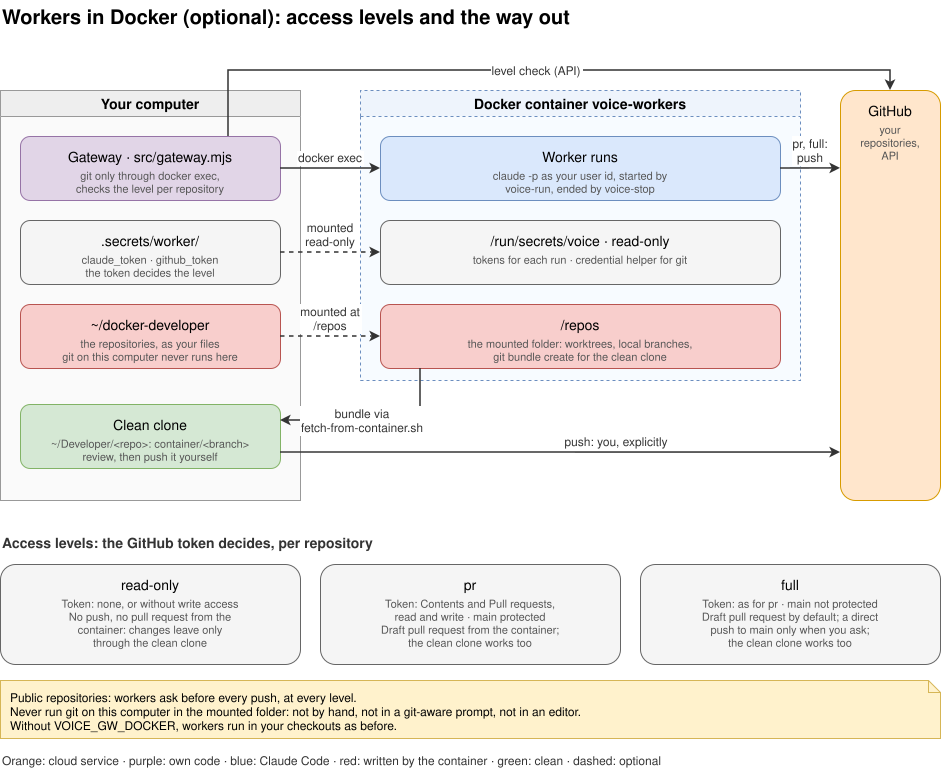

**The container** (`docker/Dockerfile`, `scripts/start-workers-container.sh`):

- **Image:** `node:22-bookworm-slim` with git, `gh`, procps and Claude Code. Its user `worker` has
  your user and group id.
- **Started with** `--user <uid>:<gid> --init --restart unless-stopped`.
- **Mounts:** the folder of clones at `/repos`, read-write, or read-only while the kill switch is
  locked; the volume `voice-home` at `/home/worker`; `.secrets/worker` at `/run/secrets/voice`,
  read-only.
- **Tokens:** `voice-run` reads them for each run (`CLAUDE_CODE_OAUTH_TOKEN`, `GH_TOKEN`). git
  gets the GitHub token from the credential helper `git-credential-voice`. They are never part of
  the container's configuration.
- **Docker itself:** whoever controls the gateway can control Docker, which on Linux is as good as
  root.

#### Several runs per repository

By default a repository has one run at a time, and the rest of its tasks wait in the queue.
`VOICE_GW_MAX_WORKERS_PER_REPO` (`1`), or "Runs per repository" in the setup assistant, allows more.
`VOICE_GW_MAX_WORKERS` stays the limit over all of them: every run of a repository counts, so it
still protects your subscription.

- **Where they run.** The first run of a repository works in its checkout, as always. Every
  further one works in a git worktree of its own, in
  `<VOICE_GW_WORKER_ROOT>/.voice-worktrees/<repository>/<task id>`: outside every checkout, and
  not listed as a repository because of the dot. In Docker the same, in the container's clones
  under `/repos/.voice-worktrees`, every git command through `docker exec`.
- **How a worktree is made.** The gateway fetches the branch the checkout's run would start from
  (`origin/<branch>`, usually the default branch) and adds the worktree there, on a detached
  HEAD. Submodules come from the checkout's own modules, a local clone that downloads nothing, also
  for a shallow one such as `drawio` in traffic; only a commit the checkout's module lacks comes
  from the submodule's URL, as one shallow commit. Where the checkout has not initialised a
  submodule, it is a shallow clone from its URL. The URL goes with `-c`, so the checkout's config
  stays as it was. A submodule that fails is named in the worker's prompt, and the run starts all
  the same.
- **Its own session and rules.** A run in a worktree has a Claude session of its own, not the
  repository's, and the same options, denied tools, environment, marks and time limit as any run.
  For the kill switch's rule on writes, its worktree is its repository; the checkout is outside.
  Its prompt says how it works there: create its `voice/` branch there and stay on it; before
  pushing, `git fetch origin`, rebase onto the branch its pull request goes to (or the default
  branch, where pull requests are off or with `direct`), run the tests, resolve conflicts itself
  and run the tests again; push only when they pass, a branch of its own that was pushed before
  with `--force-with-lease`; where pull requests are off, `git push origin HEAD:<default branch>`.
- **Who waits for whom.** The controller decides per task, without asking you: `parallel` when
  it needs none of the other tasks' results and works on other files, `after` with the ids of
  runs or queued tasks it must wait for, or neither, which keeps it behind everything the
  repository had when it came. `dispatch=queued` lists the runs and queued tasks there with their
  texts; `order_queue` changes how a queued task waits later, without your words, as it changes
  only the order, not what is done. Its confirmation says in a few words whether it runs in
  parallel or what it waits for, and why. A task waits until a run slot and a slot in its
  repository are free and what it waits for has ended.
- **Follow-ups and answers.** A follow-up for a run in a worktree goes there (`continues`), and
  your answer to a run's result goes there by itself: the same worktree and session. A worktree
  removed meanwhile is made again at the same path, on the branch its run ended on, so that the
  session continues.
- **After a run.** The gateway's git check looks at the worktree: the commits its HEAD has and its
  files; a run in the checkout is not blamed for the commits of runs in worktrees. With nothing
  uncommitted, nothing unpushed and no commit only its HEAD has, the worktree is removed;
  otherwise it is kept, and the push decision names it. A decision about a worktree holds only the
  tasks for that worktree. `list_workers` and `worker_status` show every run and the kept
  worktrees; the result event says `worktree="…"`. Kept worktrees that nothing needs any more are
  looked at again every ten minutes, and removed once nothing would be lost.
- **Interrupted runs.** A run in a worktree that a restart of the gateway or the computer, the time
  limit, a crash or `stop_worker` interrupts goes back to the queue with its worktree, in front for
  its repository, at most three times. At its turn it resumes there, in its session where that can
  be continued, finishes, rebases, tests and pushes, and only then is the worktree removed. Its
  result event says so (`requeued="q…"`). `stop_worker` with the run's own id in `drop` stops it
  for good. The kill switch is the exception: it empties the queue as always and stops every run,
  but keeps their worktrees, each as an open decision that holds nothing; after the unlock,
  `dispatch` with `continues` finishes one there.
- **A changed limit.** The queue remembers the limit it was planned for (`.state/workers.json`).
  Raised, at a start or in the settings file while the gateway runs, the controller gets an event
  with `kind="plan"` that lists the queued tasks that could now run next to others, with their
  texts, and marks them with `order_queue`. Lowered, the tasks run one after the other again by
  themselves. Runs going always run to the end, also above a lower limit: nothing new starts in
  that repository until it is below.

| | Run in the checkout | Run in a worktree |
|---|---|---|
| Folder | `VOICE_GW_WORKER_ROOT/<repository>` | `VOICE_GW_WORKER_ROOT/.voice-worktrees/<repository>/<id>` |
| Starts from | The branch the checkout is on | That branch as `origin` has it, fetched just now |
| Session | The repository's | Its own, kept for follow-ups there |
| At the end | Back on its starting branch | On its own branch; rebased, tested, pushed |
| Interrupted | Ends; its result says so | Back in the queue, in front, with its worktree |

#### Work folders

Off by default; `VOICE_GW_SCRATCH=1`, or the setup assistant, turns them on. A task that needs no
repository, such as a question to look up, research, a calculation, a draft or a conversion, then
gets a work folder: a new empty folder of its own (`src/workspaces.mjs`). Each run in one is a
worker run like any other, with the same options, denied tools and environment as above.

- **Where.** In `VOICE_GW_SCRATCH_ROOT` (`~/voice-scratch`), as `<date>-<id>`, mode 0700. The
  root must lie outside every git repository, this checkout and the repositories folder, and not be
  the home folder itself; otherwise the gateway leaves work folders off and logs why
  (`work folders off: …`).
- **The tools.** The controller uses the same ones: `dispatch` with the worker `scratch/new` makes
  a folder and answers with its name, `scratch/<id>`; follow-ups and answers go to that name and
  continue in the same folder and Claude session. `list_workers` shows `scratch/new` and the last
  used work folders; `worker_status` and `stop_worker` take their names. `direct`, `draft` and
  `allow_dirty` have no effect there, and `dispatch` says so.
- **Runs at a time.** New ones take any free slot of `VOICE_GW_MAX_WORKERS` and count against it,
  as many as there are slots; in each folder one run at a time, whatever
  `VOICE_GW_MAX_WORKERS_PER_REPO` says. The rest waits in the queue, as for repositories.
- **The same safety.** Only on your words from a recent voice request
  ([5.4](#54-approvals-by-voice)); the kill switch stops their runs, empties their queue and makes no
  new folder while locked; the queue, the folders and their sessions survive restarts in
  `.state/workers.json`.
- **Only that folder to write.** The rule on writes outside ([5.9](#59-the-kill-switch)) allows a
  run in a work folder only its folder, the temporary folders and its own Claude Code memory folder:
  not `VOICE_GW_KILL_ALLOW_PATHS`. Its rules say so, and to name the files it made, push nothing and
  change nothing elsewhere. So a run that writes to the home folder locks the switch at `auto`.
- **After a run** the gateway looks at the folder itself, whatever the worker wrote: the files it
  made, changed and removed. There is no git, so there is no push decision. The result event
  carries `files="2 files made, 1 changed"` instead of `git`, and a line with the names and where
  the folder is.
- **Removed** `VOICE_GW_SCRATCH_DAYS` (60) days after its last run, with its session, unless a run
  goes, a task waits or a decision is open there; with `0`, never. Folders in the root that the gateway did not make
  stay, and so does everything while work folders are turned off. A run that began before they
  were turned off is still followed where it runs.

**In a container of their own** (`VOICE_GW_SCRATCH_DOCKER`, empty by default): for a protected
environment, their runs run in a container from the worker image instead of on this computer.

- **Started with** `scripts/start-workers-container.sh --scratch`, which the setup assistant runs:
  `--user <uid>:<gid> --init --restart unless-stopped`, the root at `/scratch`
  (`VOICE_GW_DOCKER_SCRATCH`), read-write or read-only while the kill switch is locked, its own
  volume `voice-scratch-home` at `/home/worker`, and of the secrets only
  `.secrets/worker/claude_token`, as a file of its own: no GitHub token, no repositories. A new
  token counts once the container starts again.
- **Not the workers' container.** The gateway and the script refuse its name; with workers in
  Docker, the two are separate containers from the same image.
- **Through `docker exec`.** The gateway makes a folder, lists it after a run and removes it in the
  container, as it runs every git command there; on this computer it never walks or deletes what a
  run could have laid out, such as a link to your home. Runs start and stop with `voice-run` and
  `voice-stop`, as in the workers' container.
- **The kill switch** stops it and takes its restart policy; the gateway stops it again if it runs
  with a writable folder while locked.

| | Work folders on this computer | In their container |
|---|---|---|
| Runs as | You, in the work folder | Your user id, in the work folder at `/scratch/<date>-<id>` |
| Reaches | Everything your user can | The work folders, Claude Code's token, the network |
| GitHub | Your `gh` login, which its rules forbid it to use for anything but reading | Nothing beyond what anyone can read |
| Isolation | None; the rules only observe | The container |

### 5.6 Access levels and their detection

In Docker, each repository gets a level (`src/access.mjs`). `list_workers` and `dispatch` show it
with the reason, for example `access pr (main is protected by a ruleset)`.

| Level | Token | Default branch | Workers |
|---|---|---|---|
| `read-only` | None, or one that cannot push or open pull requests | Any | Commit on a local `voice/` branch. Never push, never open a pull request ([4.5](#45-pushing-from-a-read-only-container)) |
| `pr` | Can push (Contents) and open pull requests | Protected by branch protection or a ruleset | Push a `voice/` branch and open a pull request |
| `full` | As `pr` | Not protected | A pull request by default; a push to the default branch only when you ask, through `dispatch` with `direct` |

**How the level is detected**, per repository:

1. **No token or no GitHub remote:** `read-only`.
2. **Can your account push?** It asks `GET /repos/{owner}/{repo}`; `permissions.push` false
   means `read-only`.
3. **Can the token write?** It sends two write requests without content, `POST …/git/refs` and
   `POST …/pulls`. GitHub answers 422 when the token may write and 403 or 404 when not; neither
   creates anything. Either one failing means `read-only`. In a repository with pull requests
   turned off (`has_pull_requests` false), only the first is asked.
4. **Is the default branch protected?** It looks at branch protection (`GET …/branches/{branch}`)
   and the rulesets (`GET …/rules/branches/{branch}`). Protection, or a ruleset of type
   `pull_request`, `update`, `required_status_checks` or `merge_queue`, means `pr`; otherwise
   `full`. Rulesets answering 403 or 404, for example on a private repository without GitHub Pro,
   count as none.
5. **Whatever it cannot tell counts as the lower level.**

**Pull requests turned off.** In Settings > General > Features, pull requests can be turned off for
a repository. There is nothing to open then, so a worker commits on the default branch and pushes
it there:

- In Docker this happens at `full`, shown as `access full (pull requests are turned off, main is
  not protected: direct push)`. With the default branch protected, nothing could be published, so
  the repository is `read-only`.
- On this computer, `gh api repos/{owner}/{repo}` tells; `list_workers` shows `pull requests off:
  pushes to main`.
- `dispatch` answers with `push=direct`, and the kill switch's rule on the default branch
  ([5.9](#59-the-kill-switch)) lets such a run push there, as after an explicit `direct`.
- Public repositories still need your yes before the push. With pull requests limited to
  collaborators (`collaborators_only`), nothing changes: workers open pull requests as before.

The token is read at every check, and each result is kept for ten minutes (one minute after an
API error). `VOICE_GW_ACCESS=read-only|pr|full` sets one level for every repository instead. A
level is only as strict as the token: a worker forced to `read-only` with a write token could still
push; only its rules forbid it.

**The repository is pinned.** The level is detected for the GitHub repository that the clone's
origin names, and the kill switch watches that one ([5.9](#59-the-kill-switch)). A worker in the
container can change the origin, so the gateway keeps the repository it saw first for each clone,
in `.state/workers.json` under `origins` ("no GitHub remote" counts too). If the origin later names
another one:

- `dispatch` answers `dispatch=origin` and starts nothing, also with `direct`.
- `list_workers` shows `the origin changed in the container from acme/x to acme/y; check it at
  the desk`.
- At the desk, set the origin back in the container:
  `docker exec voice-workers git -C /repos/x remote set-url origin <url>`. If you changed it
  yourself, stop the controller (`scripts/start-controller.sh --stop`), remove the clone's line
  under `origins`, and start it again.

Creating tokens:

| For | GitHub token |
|---|---|
| `read-only`, public repositories | None |
| `read-only`, private repositories | [Fine-grained][pat-fine]: only the chosen repositories, Contents: Read-only. Not a classic token: its `repo` scope can also write |
| `pr` and `full` | [Fine-grained][pat-fine]: Contents and Pull requests: Read and write; Workflows: Read and write only if workers should change `.github/workflows`. Or a [classic token][pat-classic] with `repo` (and `workflow`), for all your repositories |
| `pr` additionally | A [ruleset][rulesets] on the default branch that requires pull requests, with an empty bypass list, or branch protection with "Do not allow bypassing". On private repositories this needs GitHub Pro, Team or Enterprise |

An organisation may have to approve a fine-grained token first ([personal access tokens][pat]).

### 5.7 The mounted folder and the clean clone

**Rules:**

1. **git on this computer never runs in the mounted folder.** Not by hand, not through a
   git-aware shell prompt, not through an editor that opens the folder. The gateway runs every git
   command for the container through `docker exec`.
2. **Changes come out only as a bundle into a clean clone** outside the folder
   ([4.5](#45-pushing-from-a-read-only-container)). The helper refuses a clean clone inside the
   folder.
3. **Review before you push or check out.** A checkout applies the branch's `.gitattributes` with
   filters configured on this computer, such as git-lfs. Workflow files under `.github/` run on
   GitHub with the repository's secrets.

**Why, checked with git 2.53:**

- **Fetching from the folder starts the container's side.** A fetch from a local path, plain or
  `file://`, starts `git upload-pack` in the source repository, which reads that repository's
  config. A container-side `uploadpack.hideRefs` decided which branches the host could fetch.
- **No command ran that way, but the surface is open.** git ignores `uploadpack.packObjectsHook`
  from a repository's own config, upload-pack runs no hooks, and since 2.45.1 it refuses the lazy
  fetch of a crafted partial clone (CVE-2024-32004). Still, the host opens a repository the other
  side controls, and every config key that upload-pack honours widens that.
- **No flag avoids it.** `--no-local` does not exist for `git fetch`. `protocol.file.allow=never`
  blocks local paths and bundles alike.
- **`git status` in the folder ran a container-side `core.fsmonitor` command.** That is rule 1.
- **A bundle is data:** a list of refs and a pack. Fetching it reads no config of the other side,
  runs no hook and needs no repository there. Fetching it, `git log -p` and `git diff` ran nothing.
  A checkout did run a filter from `.gitattributes` (rule 3).

**Threat model:** anything in the container may be hostile; a worker controls every file in the
folder, `.git` included.

- **What this protects:** nothing from the folder runs on this computer, and nothing goes to
  GitHub from this computer unless you push it.
- **What it does not do:** judge whether the changes are good.
- **Above `read-only`:** at `pr` and `full` the container pushes by itself, within its token.

### 5.8 The Telegram fallback

- **On only with both files:** `.secrets/telegram_token` and `.secrets/telegram_chat_id`.
- **When:** after `VOICE_GW_TELEGRAM_AFTER` seconds (600) without a voice tool call, voice mode
  counts as ended. Gaps of a few minutes between calls are normal while you talk, so the wait is
  long.
- **What:** only what needs you. Questions and approval requests that voice mode has not picked
  up then also go to the chat, each once. Results, news and interim `working` updates never do;
  they wait for the next voice call. A question the controller settled in the meantime is not
  sent.
- **Not waiting for that:** the kill switch alarm goes at once, whether voice mode is on or not,
  and so do a note when the gateway ends because another process holds its port, the alerts
  about suspicious requests and sign-ins ([5.2](#52-the-voice-endpoint-and-oauth)), the Funnel's
  messages ([7.3](#73-publishing-the-endpoint)) and the watchdog's.
- **Inbound:** only the kill switch (`/stop`, `/killswitch`, `/emergencystop` or an emergency
  phrase) and the Funnel (`/funnel on`, `/funnel off`, `/funnel`, "keep alive";
  [7.3](#73-publishing-the-endpoint)), only from the configured private chat. Everything else is
  ignored. You cannot answer questions or approvals by Telegram.
- **Only if recent.** A command counts only if Telegram's timestamp on it is at most two minutes
  old when the gateway reads it. Telegram keeps messages for a day, and a `/stop` or `/funnel on`
  sent while the gateway was not running must not act hours later. Such a command gets an answer
  instead: "Ignored "/funnel on": it was sent 15 minutes ago, while the gateway was not
  listening… Send it again if you still want it."
- **Through Telegram's servers.** Bot chats are not end-to-end encrypted, so leave the files out
  if that is not acceptable.
- **The token** never appears in a log line or error message.

### 5.9 The kill switch

One lock in the gateway's code (`src/killswitch.mjs`, `src/guard.mjs`). It does not depend on the
controller following instructions.

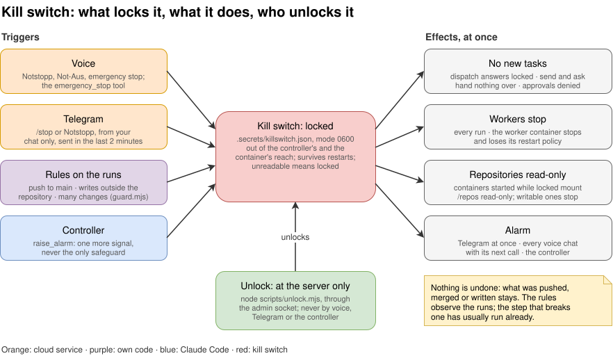

**What locks it** is a setting, `VOICE_GW_KILLSWITCH`, also in the setup assistant:

| Setting | Locks it | The rules |
|---|---|---|
| `auto`, the default | Every trigger below | Lock it |
| `manual` | Voice, Telegram and the controller | Only write to the gateway log what they would have done (`kill switch not locked, VOICE_GW_KILLSWITCH=manual; rule would have locked it: …`) |
| `off` | Nothing; each trigger is only logged | Only log, as at `manual` |

At `off`, "emergency stop" by voice answers that the kill switch is off and hands nothing over,
`/stop` on Telegram gets the same answer there, and `raise_alarm` tells the controller to tell you;
workers can still be stopped one by one with `stop_worker`. The setting decides only what locks it
from now on: a lock from before stays until you unlock it, and the gateway's log names the setting
at every start.

**Triggers:**

| Trigger | How | Checked |
|---|---|---|
| Voice | "emergency stop" or "kill switch"; or the tool `emergency_stop`, which the voice AI calls for the same words in any language | In `send` and `ask` before anything reaches the controller: the message starts with the phrase, or has at most six words |
| Telegram | `/stop` or a phrase | See 5.8 |
| Rule: default branch | A push to the default branch, or a merge, without a direct dispatch at level `full`, in a repository with pull requests turned on | In the run's commands: `git push` to the default branch, `--all`, `--mirror`, `gh pr merge`, and `gh api` calls that merge (`PUT …/pulls/<n>/merge`, `POST …/merges`, the GraphQL mutations `mergePullRequest`, `enablePullRequestAutoMerge`, `mergeBranch`). With `gh`, every `VOICE_GW_KILL_CHECK` seconds and at the end: the default branch moved on GitHub, and the worker's repository holds the new head, or the new head merged a pull request of the run (below) |
| Rule: outside | Writes outside the repository (for a run in a [worktree](#several-runs-per-repository), outside its worktree), `/tmp`, `/var/tmp` (and the system's temp folder on this computer), the run's own Claude Code memory folder (`~/.claude/projects/<repository path with - for every other character>/memory`, where auto memory writes; another project's is outside) and `VOICE_GW_KILL_ALLOW_PATHS`; for a run in a [work folder](#work-folders), writes outside that folder, those temporary folders and its memory folder; writing to `/dev/null`, the standard streams, a terminal or `/dev/fd/N` is none | The file tools by path. Shell commands by explicit targets: redirections, `tee`, `cp`, `mv`, `rm`, `mkdir`, `touch`, `ln`, `chmod`, `chown`, `truncate`, `sed -i`, `dd of=`, also after `cd`; `$HOME` and `~` are expanded. The command line is read as a shell reads it: quoted text, comments, here-strings and heredoc bodies are data, so a `>` or `;` in a pattern, a commit message or a script written to a file is none; the commands in `$(…)`, backticks, `<(…)`, `>(…)`, `sh -c`, `eval` and a heredoc a shell reads are checked like any other, and so is a script written from a heredoc that the same call runs |
| Rule: many changes | More than 500 file edits in a run; at its end more than 300 files or 30,000 lines changed; in a work folder, more than 300 files in it | Edits as they happen; at the end the commits made during the run plus what is not committed, or the files in the work folder. `VOICE_GW_KILL_MAX_*` |
| Controller | `raise_alarm` with a reason | One more signal, never the only one |

**Whose merge it is.** A merge on GitHub makes a commit that the worker's repository does not
have. So when the default branch moved to such a commit, the gateway asks
`gh api repos/{owner}/{repo}/commits/{sha}/pulls` which pull request it merged. That merge counts
as the run's when:

- **the run pushed the pull request's branch:** named in a `git push`, or logged in the worker's
  repository as a push since the run started (the reflog of `origin/<branch>`); or
- **the pull request was opened during the run,** from a `voice/` branch.

A pull request that was there before the run, and that the run did not push to, is not the run's:
your merge at the desk of an earlier worker's pull request does not trip the switch. Your merge of
the running worker's own pull request does, so wait until the run has ended. GitHub cannot tell
who merged when you and the workers use the same account. Direct dispatches and repositories with
pull requests turned off are exempt, as for pushes.

**Effects**, at once:

- **No new work:** `dispatch` answers `locked`, also a dispatch whose checks were still running
  when the switch tripped; `send` and `ask` hand nothing over. The queue is emptied, and the
  controller's alarm names its tasks: they do not start after the unlock by themselves.
- **Approvals:** open ones are denied, new ones are denied automatically.
- **Workers:** every run stops, with every process it started, also a run that is ending or
  making its worktree, and so do worker processes that no run accounts for and a clone that is
  going. A run in a worktree does not go back to the queue: its worktree is kept, as an open
  decision that holds nothing. With Docker the container stops and loses its restart policy, and
  so does the work folders' container.
  While locked, `scripts/start-workers-container.sh` mounts the folder read-only, and the gateway
  stops a container with a writable `/repos`, or a work folders' container with a writable
  folder, within `VOICE_GW_KILL_CHECK` seconds.
- **Alarm:** to Telegram at once, to every voice chat with its next call (`[ALARM]`), and to the
  controller.
- **State:** saved in `.secrets/killswitch.json`, mode 0600; it survives restarts. A file that
  cannot be read counts as locked.

**Unlocking**, only at the server's terminal:

```bash
node scripts/unlock.mjs --status   # what locked it
node scripts/unlock.mjs            # asks you to type "unlock"
scripts/start-workers-container.sh # Docker: start the container again
scripts/start-workers-container.sh --scratch # and the work folders' container, if you use one
```

It unlocks the running gateway through the admin socket, or removes the file. There is no way to
unlock by voice, Telegram or the controller.

### 5.10 Secrets and files

| Path | Content | Mode |
|---|---|---|
| `.secrets/` | Folder for everything below | 0700 |
| `.secrets/oauth.json` | Clients and grants, hashes only | 0600 |
| `.secrets/admin.sock` | Admin socket of the running gateway | socket in the 0700 folder |
| `.secrets/gateway.env` | Settings from the setup assistant | 0600 |
| `.secrets/telegram_token`, `.secrets/telegram_chat_id` | The Telegram bot | 0600 |
| `.secrets/killswitch.json` | Kill switch state, present while locked | 0600 |
| `.secrets/worker/claude_token`, `.secrets/worker/github_token` | The container's logins, mounted read-only into it; into the work folders' container only `claude_token` | 0600, folder 0700 |
| `.state/` | Worker state, run output, open requests and decisions, watched pull requests, the watchdog's lock | 0700 when the gateway creates it |
| `.state/tasks/`, `.state/workers.json` | Each run's output with every tool input and result; the workers' state, with the queue, the worktrees, the limit per repository the queue was planned for, and the work folders | 0600, folder 0700 |
| `VOICE_GW_WORKER_ROOT/.voice-worktrees/<repository>/<id>` | The worktrees of further runs of a repository ([several runs per repository](#several-runs-per-repository)), while something is left in them | As git makes them |
| `~/voice-scratch/<date>-<id>` (`VOICE_GW_SCRATCH_ROOT`) | The work folders, with what their runs made | 0700, and the root too when the gateway or the start script makes it |
| `.state/requests.json` | Voice requests and the answers, with what the voice client has read | 0600 |
| `.state/jobs.json` | Open decisions, with the driver's answers, and the last 100 closed ones for a week | 0600 |
| `.logs/gateway.log`, `.logs/gateway.log.1` | Log, without tokens; rotated at `VOICE_GW_LOG_MAX_MB` | 0600, folder 0700 when the gateway creates it |

Folders created by an earlier version keep their mode; tighten them once with
`chmod 700 .state .logs`.

`.secrets/`, `.state/` and `.logs/` are ignored by git. The controller's confinement keeps it
away from `.secrets/`; the container sees only `.secrets/worker`.

### 5.11 The setup assistant

It runs only while you set up, listens on every interface by default (for headless servers), and
is guarded as follows:

- **One-time link:** a token of 256 random bits, shown only on the terminal and compared in
  constant time. With its output in a pipe or a file the assistant does not start, so the link
  never lands in a log.
- **One browser:** the first use spends the token and binds the setup to that browser with an
  HttpOnly, SameSite=Strict cookie.
- **Wrong links:** after five from one address in ten minutes, or 30 in total, every attempt is
  refused for a while.
- **Write requests** must come from the page's own origin, as JSON. The page has a strict Content
  Security Policy, sends no referrer and is not cached.
- **It ends by itself:** after 10 minutes without activity (`--idle`), after 30 minutes at most
  (`--timeout`), after writing, and on Cancel.
- **Plain HTTP, by decision:** a notice at the top of the page says to use it only on your own
  network, since the one-time token and the keys travel unencrypted. From elsewhere, use an SSH
  tunnel.
- **No secret leaves it.** None goes back to the browser (saved ones show as `••••••••`), to the
  terminal or to a log. Output of the commands it runs shows a known secret as `‹secret›`.

### 5.12 Limits

- **Nothing is undone.** A push, a merged pull request or a deleted branch stays as it is. The kill
  switch stops what comes next.
- **The rules see a step only after it ran.** They read the commands Claude Code reports; the
  command that breaks a rule has usually run already.
- **Hidden actions are missed.** Not seen:
  - a push or a write inside a script, an alias or another language; of a shell script that `cat`
    or `tee` writes from a heredoc, only what the same Bash call runs is seen;
  - targets in variables other than `$HOME`, and relative targets after a `cd` into one;
  - writes by programs, such as `npm install` into `~/.npm`;
  - paths behind symlinks.

  A worker that fetched someone else's push can look guilty. A push whose commit the worker did
  not keep is missed. A merge that you approved through the controller while a worker in the same
  repository fetches can also look like the worker's push.
- **On this computer the kill switch is a tripwire, not a boundary.** Host workers run as you,
  without approvals. They can write `.secrets/` (including `killswitch.json` and `gateway.env`),
  use your SSH keys and `gh` login, and change this repository's code (the gateway, the confine
  hook, `controller/CLAUDE.md`), which takes effect at the next restart; leaving this checkout out
  of the workers ([5.5](#55-workers-on-this-computer-or-in-docker)) only keeps runs from starting
  in it. A process that clears its environment and leaves both the run's process group and the
  tree below it can survive a stop; on systems without `/proc`, such as macOS, so can one that
  only leaves the group and the tree. **Only Docker isolates.** The same holds for
  [work folders](#work-folders) on this computer: their rule on writes is stricter, but a run there
  can read and do everything your user can; in their container it reaches only the work folders.
- **Several runs in one repository share its git.** Their worktrees share its objects and refs.
  The rule on the default branch cannot tell whose commit a new head is while another run there
  may push straight to it (`direct` at `full`), so it lets that go; and the count of changes at
  the end leaves out the branches other runs pushed and their worktrees' commits only as far as
  this gateway saw them. Whether two tasks touch the same files is the controller's judgement,
  from their texts; a conflict is resolved by the run that pushes second, when it rebases.
- **The container's scripts come with the image.** `voice-run` and `voice-stop` are copied into
  it when it is built; rebuild it (`docker build`, see `docker/Dockerfile`) for a newer version.
- **In Docker,** the container can do what its token allows on GitHub, and reaches the network.
- **The controller reads untrusted text.** Worker results, pull request news and what read-only
  `gh` shows reach it. `trusted="no"` and its instructions ask it to treat them as data; that is
  an instruction, not enforcement. The dispatch check ([5.4](#54-approvals-by-voice)) holds in
  code, but a phrase you said within `VOICE_GW_DISPATCH_WINDOW` can be reused for another task,
  and the controller writes the task itself. Merges still need your approval; its answers to you,
  `restart_controller` and `raise_alarm` are not checked. Of an open decision, the gateway makes
  sure that the controller asks you, not how well.
- **The voice AI is an instruction-follower.** If it rewrites "emergency stop" into a longer
  sentence, the phrase check can miss it, and the check knows only English; the `emergency_stop`
  tool is there for that. Approvals depend on
  it asking you.
- **The endpoint is public.** The pairing code protects the sign-in, and `/mcp` answers through the
  tunnel only Anthropic's addresses; but every Claude account calls from those too, and the sign-in
  pages answer everyone. Nothing limits the request rate, and nothing protects the availability.
- **Above `confined`, more rests on the sign-in.** At `clone-delete`, a deletion needs words and
  an approval that whoever can call the connector can give. At `unrestricted`, nothing in this
  design limits the controller, and the kill switch's rules do not watch it.
- **Run it on a computer or VM you can afford to lose,** and when in doubt:
  `node scripts/pair.mjs revoke all`.

## 6. Prerequisites

| Component | Version | Needed for | Notes |
|---|---|---|---|
| Node.js and npm | Node.js 20 or later (`engines` in `package.json`); tested with 22.22.1 and npm 10.9.4 | The gateway, scripts, tests | npm comes with Node.js |
| Claude Code | 2.1.80 or later for channels, 2.1.81 for the permission relay, 2.1.84 for `allowedChannelPlugins` (plugin mode). Tested with 2.1.310 | Controller and workers | Logged in with claude.ai. Channels need claude.ai or Console authentication; not on Amazon Bedrock, Google Cloud's Agent Platform or Microsoft Foundry ([channels][channels]) |
| Claude subscription | See below | Voice mode, connector, channels, `setup-token` | |
| git | 2.29 or later on the host for `scripts/fetch-from-container.sh` (`--no-write-fetch-head`); tested with 2.53.0 | Workers, the fetch helper | The container brings its own (Debian bookworm) |
| GitHub CLI `gh` | Tested with 2.46.0 | Host workers (push, pull requests), the controller's status questions and merges, the pull request watch, the kill switch's default-branch check | `gh auth login` on this computer |
| Docker | Tested with 29.8.0 | Optional: workers in a container | Docker installed as a snap cannot mount folders from `/tmp` |
| tmux | Tested with 3.6 | Optional: the controller in the background | The setup assistant's autostart uses it |
| systemd user services | – | Optional: autostart at boot on Linux | With lingering (`loginctl enable-linger`), which the setup assistant turns on; without it, only at a login and until the last logout |
| launchd (macOS) | – | Optional: autostart at login on macOS | A LaunchAgent, which the setup assistant writes and loads; at boot only with automatic login |
| bash | 3.2 or later | The start scripts | macOS's `/bin/bash` 3.2 will do; no GNU tools needed |
| A public HTTPS address on port 443 | – | Claude's servers reach the gateway | Tailscale Funnel (tested, 1.104.2) or a reverse proxy |
| Claude app | Current | Voice mode with the connector | Used on the iPhone |

**What `npm install` installs:**

- **Two direct dependencies,** from `package.json`:
  - `@modelcontextprotocol/sdk` `^1.32.2` (installed 1.32.2): the MCP server for both sides (stdio
    and Streamable HTTP), and the clients in the tests;
  - `zod` `^4.6.7` (installed 4.6.7): schemas for the tool inputs.
- **What the SDK brings:** `@hono/node-server`, `ajv`, `ajv-formats`, `content-type`, `cors`,
  `cross-spawn`, `eventsource`, `eventsource-parser`, `express`, `express-rate-limit`, `hono`,
  `jose`, `json-schema-typed`, `pkce-challenge`, `raw-body`, `zod-to-json-schema`, and their
  dependencies.
- **In total,** 95 packages in `node_modules`, pinned by `package-lock.json`. Nothing is compiled.

**Operating systems:**

- **Tested:** Ubuntu 26.04.1 LTS, for the gateway, workers on the host and in Docker, the
  watchdog and the setup assistant. The controller's Bash allowlist exists because of Ubuntu
  24.04+.
- **macOS:** supported, with Homebrew's `node`, `git`, `gh` and `tmux`, the `claude-code` cask,
  and Tailscale and Docker Desktop where wanted; [install and test on a Mac](docs/macos.md). The
  scripts run with macOS's own `/bin/bash` 3.2 and BSD tools; the test suite checks them with bash
  3.2. What differs from Linux:
  - **Autostart:** a LaunchAgent, `~/Library/LaunchAgents/com.drawio.cc-voice-gateway.plist`, that
    starts the controller in tmux at login (not at boot: with automatic login it comes back after a
    restart). The setup assistant writes it with your `PATH` plus Homebrew's folders, checks it
    with `plutil` and loads it with `launchctl` ([7.2](#72-by-hand), [8.1](#81-starting-and-stopping)).
  - **Sleep:** while the watchdog runs, `caffeinate` keeps the Mac from idle sleep
    (`VOICE_GW_CAFFEINATE=0` turns it off). A closed laptop lid still sends it to sleep.
  - **Paths:** the managed settings in `/Library/Application Support/ClaudeCode/`; the temporary
    folders the kill switch allows include `/private/tmp` and `/var/folders/…/T`; the Tailscale
    app's command line is found without "Install CLI".
  - Written and checked on Linux, with bash 3.2 in Docker and the macOS code paths in the tests;
    the first run on a Mac follows the checklist in [docs/macos.md](docs/macos.md).
- **Windows:** through WSL 2. Follow the Linux instructions inside WSL (Ubuntu); the gateway,
  tmux and the workers run there, and the autostart is a systemd user service if WSL runs systemd.
  Nothing runs on Windows itself.
- **Phone and car:** the Claude app on the iPhone, in the car with CarPlay. Android and Android
  Auto are not tested; nothing in the gateway is specific to either.

**Claude subscription.** The account that runs Claude Code and the account in the Claude app may
differ.

| Feature | Plans | Admin step on Team and Enterprise |
|---|---|---|
| Voice mode in the Claude app | All plans ([voice mode][voice]) | – |
| Custom connector (remote MCP) | Free (one connector), Pro, Max, Team, Enterprise ([connectors][connectors]) | On Team, only Owners and Primary Owners add connectors |
| Claude Code channels | Pro and Max without an admin step ([channels][channels]) | An Owner enables channels: Organization settings → Claude Code → Channels, or `channelsEnabled: true` |
| Remote Control for the controller, optional | Pro, Max, Team, Enterprise; not with an API key or a token from `setup-token` ([Remote Control][rc]) | An Owner turns on Remote Control: Organization settings → Claude Code |
| Channel plugin without the prompt | Team and Enterprise managed setting `allowedChannelPlugins` ([channels][channels-admin]) | Owner, see [7.4](#74-admin-steps-for-team-and-enterprise) |
| `claude setup-token` for the container | Pro, Max, Team or Enterprise ([authentication][auth]) | – |

On a Team plan this means:

- an Owner enables channels and adds the custom connector;
- optionally, an Owner puts the plugin on the channel allowlist;
- `claude setup-token` works.

A token from `setup-token` can only make model requests; it is used for the workers in the
container, not for the controller. It cannot open a Remote Control session either.

## 7. Installation

### 7.1 With the setup assistant

```bash
gh repo clone alderg/cc-voice-gateway && cd cc-voice-gateway
npm install
node scripts/setup.mjs
```

The assistant prints a one-time link per address of the computer. Open one in a browser on your
own network. It is a local setup over plain HTTP: the one-time token and the keys you enter travel
unencrypted. From anywhere else, use an SSH tunnel (`ssh -L 8790:localhost:8790 <server>`, then
the `localhost` link).

| Step | What the assistant does | What you give it |
|---|---|---|
| This computer | Checks Node.js, `npm install`, Claude Code (2.1.80+), git, the `gh` login, Docker, tmux, Tailscale | Fixes for what is marked as needed |
| Gateway | Port, repositories folder, runs at a time and per repository (both apply at once in a running gateway), time limit, approvals by voice, Remote Control for the controller (off by default), what the controller may do (with a warning above `confined`), what locks the kill switch (with a warning below `auto`), the Funnel off when idle and after how many minutes | Choices |
| Models | Model and effort for the controller (`--model`, `--effort` from `start-controller.sh`) and for every worker run, on the host and in Docker. Claude in Chrome for the controller (off by default); turned on, a warning unless Claude in Chrome's notice for the first start is confirmed already (below) | Choices, or Claude Code's defaults |
| Telegram | Checks the token (`getMe`), finds your private chat with `getUpdates` once you wrote to the bot, sends a test message | A token from [@BotFather](https://t.me/BotFather), one message to the bot |
| Workers in Docker | Checks the GitHub token and shows the level per repository with the gateway's detection. Builds the image with its progress shown. Starts the container, sets git's name and email in it, and clones the chosen repositories inside it | A token from `claude setup-token`, optionally a GitHub token ([5.6](#56-access-levels-and-their-detection)), the repositories |
| Work folders | Off by default. Turned on: checks their folder as the gateway does, and with a container of their own, builds the image if it is missing and starts the container with `start-workers-container.sh --scratch` ([work folders](#work-folders)) | The folder, the days they are kept, and for the container its name and the token from `claude setup-token` |
| Watchdog | On Linux, writes and enables a systemd user service that starts the controller in tmux at boot, and turns on lingering for your user so that it keeps running without a login (if that is refused, it shows the `sudo` command); or starts it now in tmux. On macOS it writes a LaunchAgent that starts it in tmux at login, checks it with `plutil`, and with "start it now" loads it with `launchctl bootstrap`, which starts it (`kickstart` if it is loaded already); without, launchd loads it at the next login | Choices |
| Plugin | Shows whether `voice@cc-voice-gateway` is on the organisation's channel allowlist; registers the marketplace if it is; otherwise shows the admin steps | The admin |
| Finish | Writes `.secrets/` (5.10) and ends | – |

**Claude in Chrome.** At its first start with Claude in Chrome, Claude Code shows a notice about it
and waits for Enter at the terminal, so a restart by the watchdog or the autostart can hang there.
The start script marks it as seen before each start ([8.1](#81-starting-and-stopping)), but cannot
always. With Claude in Chrome on, the assistant therefore shows a warning, and repeats it when it
writes the setup: before relying on unattended restarts, start Claude Code once at the terminal, as
the user the controller runs as, with `claude --chrome`, confirm the Claude in Chrome notice with
Enter and leave with `/exit`. If Claude Code's config (`~/.claude.json`, or
`$CLAUDE_CONFIG_DIR/.claude.json`) says that the notice is confirmed already
(`hasCompletedClaudeInChromeOnboarding`), it says so instead; it only reads that file. If it cannot
tell, it warns.

Values equal to their default are left out of `.secrets/gateway.env`, and other settings already in
it stay. Unticking Telegram deletes its two files. Options: `--host` (`0.0.0.0`), `--port` (`8790`),
`--timeout` (minutes, `30`), `--idle` (minutes, `10`), or `VOICE_SETUP_HOST`, `VOICE_SETUP_PORT`,
`VOICE_SETUP_TIMEOUT`, `VOICE_SETUP_IDLE`. Run it again to change something.

Then go on with [Getting started](#getting-started) from step 4: start the controller, publish the
endpoint, add the connector and pair.

### 7.2 By hand

Everything the assistant does can be done with files and commands.

**Settings:** `.secrets/gateway.env`, one `VOICE_GW_NAME=value` per line, mode 0600. The values
are in [8.7](#87-configuration). The gateway (`src/settings.mjs`) and the shell scripts
(`scripts/settings.sh`) read it line by line and never execute it. Variables set in the
environment or in `controller/.mcp.json` win. The watchdog reads it again before every start of the
session, so a restart, also one by voice, takes a change; only the controller level waits for the
next start of the start script (8.2).

```bash
mkdir -p -m 700 .secrets
(umask 077; printf 'VOICE_GW_WORKER_MODEL=opus\n' >> .secrets/gateway.env)
```

**Telegram:**

```bash
(umask 077; read -rsp 'Bot token: ' t; printf '%s' "$t" > .secrets/telegram_token)
# write to the bot from your Telegram account, then:
# printf is built into the shell, so the token stays off every command line (ps)
printf 'url = "https://api.telegram.org/bot%s/getUpdates"\n' "$(cat .secrets/telegram_token)" \
  | curl -s -K - | jq '.result[].message.chat | {id, type, first_name}'
(umask 077; printf '%s' '<id of your private chat>' > .secrets/telegram_chat_id)
```

Take the `id` of the chat of type `private`. A webhook on the bot makes `getUpdates` answer
`409 Conflict`; another program polling the same bot takes the updates away.

**Docker:**

```bash
folder="$HOME/docker-developer"; mkdir -p "$folder"
docker build -t cc-voice-worker --build-arg UID="$(id -u)" --build-arg GID="$(id -g)" docker/
mkdir -p -m 700 .secrets/worker
(umask 077; read -rsp 'Claude token: ' t; printf '%s' "$t" > .secrets/worker/claude_token)
(umask 077; read -rsp 'GitHub token: ' t; printf '%s' "$t" > .secrets/worker/github_token)
VOICE_GW_DOCKER_FOLDER="$folder" scripts/start-workers-container.sh
docker exec voice-workers git clone https://github.com/<owner>/<repo>.git /repos/<repo>
docker exec voice-workers git config --global user.name "Your Name"
docker exec voice-workers git config --global user.email "you@example.com"
(umask 077; echo 'VOICE_GW_DOCKER=voice-workers' >> .secrets/gateway.env)
```

- **The Claude token** comes from `claude setup-token` on this computer.
- **The GitHub token** is optional ([5.6](#56-access-levels-and-their-detection)).
- **Clones** use `https://` addresses, since the container has no SSH keys.
  `--build-arg CLAUDE_CODE_VERSION=<version>` pins Claude Code; rebuild to update it.
- **Clean clones** for the fetch helper ([4.5](#45-pushing-from-a-read-only-container)) are
  ordinary clones from GitHub outside the folder. Your checkouts in the worker root will do: the
  helper only adds refs to them.

**Autostart on Linux:** a systemd user service that runs
`tmux new-session -d -s voice <repo>/scripts/start-controller.sh` (Type=forking, with your
`PATH`), then `systemctl --user enable cc-voice-gateway.service` and `loginctl enable-linger`, so
that it starts at boot and keeps running without a login.

**Autostart on macOS:** a LaunchAgent, `~/Library/LaunchAgents/com.drawio.cc-voice-gateway.plist`,
whose `ProgramArguments` are the same tmux command with tmux's full path (launchd does not search
the `PATH`), with `EnvironmentVariables` `PATH` (yours plus `/opt/homebrew/bin`, `/usr/local/bin`,
`~/.local/bin` and Node's folder), `WorkingDirectory` the repository, `RunAtLoad` true, `KeepAlive`
false (tmux returns at once; the watchdog restarts), `AbandonProcessGroup` true, and
`StandardOutPath`/`StandardErrorPath` `~/Library/Logs/cc-voice-gateway.log`. Then:

```bash
plutil -lint ~/Library/LaunchAgents/com.drawio.cc-voice-gateway.plist
launchctl bootstrap gui/$(id -u) ~/Library/LaunchAgents/com.drawio.cc-voice-gateway.plist  # starts it now, and at every login
```

Then go on with [Getting started](#getting-started) from step 4.

### 7.3 Publishing the endpoint

Claude's servers call the connector from Anthropic's cloud. Any tunnel or reverse proxy works that:

- serves **HTTPS on port 443** with a valid certificate (port 8443 was not reached in our tests);
- forwards **every path** to `127.0.0.1:8787`, not only `/mcp`: the sign-in uses
  `/.well-known/…` and `/oauth/…`. Do not open port 8787 itself;
- passes the **public host name** in `Host` or `X-Forwarded-Host`, and sends
  `X-Forwarded-Proto: https`: the sign-in metadata is built from them;
- adds the **caller's address** as the last `X-Forwarded-For` entry: only Anthropic's addresses
  may call `/mcp` ([5.2](#52-the-voice-endpoint-and-oauth)). A tunnel that cannot do that needs
  `VOICE_GW_MCP_ALLOW=any`;
- allows **responses of up to a minute**, since `get_reply` waits up to 40 seconds.

**Tailscale Funnel** (tested). On Linux run `sudo tailscale set --operator=$USER` once. On macOS
the script finds the Tailscale app's command line by itself; `VOICE_GW_TAILSCALE_BIN` names
another.

```bash
scripts/funnel.sh start    # prints https://<host>.ts.net/mcp; reports when all relays answer
scripts/funnel.sh stop
scripts/funnel.sh state    # on or off
scripts/funnel.sh url
```

The first start fetches a certificate; the name and all relays can take a few minutes.

**The Funnel on demand** (`src/funnel.mjs`), so that the endpoint is public only while you use it:

- **From Telegram** ([5.8](#58-the-telegram-fallback)): `/funnel on` or "keep alive" turns it
  on, `/funnel off` off, `/funnel` says whether it is on. Every command gets an answer; a start
  gets a second one once the public relays answer, usually within two minutes. So send it before
  you start driving, not with the first voice request.
- **Off by itself**, with `VOICE_GW_FUNNEL_IDLE` minutes set (the setup assistant offers it,
  90 suggested; off by default). That long after the last voice call, or after the last
  `/funnel on`, "keep alive" or gateway start, the gateway turns the Funnel off and says on
  Telegram how to turn it on again. Without Telegram, it comes back on only at the computer.
- **The gateway runs `scripts/funnel.sh`**, so the operator setting above is needed for this too.

**Reverse proxy**, for example Caddy, which gets a certificate and sets the headers by default:

```text
voice.example.com {
	reverse_proxy 127.0.0.1:8787
}
```

With nginx add `proxy_set_header Host $host;`, `proxy_set_header X-Forwarded-Proto https;` and
`proxy_set_header X-Forwarded-For $proxy_add_x_forwarded_for;`.

### 7.4 Admin steps for Team and Enterprise

On claude.ai, as Owner or Primary Owner:

1. **Enable channels:** Organization settings → Claude Code → Channels, or `channelsEnabled: true`
   in the managed settings ([channels][channels-admin]).
2. **Custom connector:** on Team, only Owners and Primary Owners add it ([connectors][connectors]).
3. **Optional, Remote Control** for the controller
   ([Remote Control](#remote-control-from-the-claude-app)): Organization settings → Claude Code →
   Remote Control, on; it is off by default there. On Enterprise with custom roles, your roles also
   need the cloud sessions and the Claude Code remote control permission ([Remote Control][rc]).
4. **Optional, the channel without the prompt.** Open
   [Organization settings → Claude Code → Managed settings](https://claude.ai/admin-settings/claude-code),
   keep what is there, and add:

   ```json
   {
     "channelsEnabled": true,
     "allowedChannelPlugins": [
       { "marketplace": "cc-voice-gateway", "plugin": "voice" }
     ]
   }
   ```

   **Before saving:** this list replaces Anthropic's default list of channel plugins for the whole
   organisation. Telegram, Discord, iMessage and fakechat from `claude-plugins-official` stop
   working as channels for every member unless the list names them too, for example
   `{ "marketplace": "claude-plugins-official", "plugin": "telegram" }`. An entry matches by name:
   whoever registers a marketplace called `cc-voice-gateway` with a plugin `voice` can load it as a
   channel, and still has to opt in per session with `--channels`.

Claude Code picks the setting up at its next start, or within an hour; `claude doctor` shows the
`Managed settings (remote)` line. Nothing is left to do on the server. The start script reads
Claude Code's local copy of these settings, which Claude Code refreshes when it starts, so the
first start after saving may still use the development flag; the one after it uses the plugin.

## 8. Operation

### 8.1 Starting and stopping

```bash
tmux new -s voice scripts/start-controller.sh   # start, with the watchdog
scripts/start-controller.sh --status            # running?
scripts/start-controller.sh --stop              # stop session and watchdog
VOICE_GW_WATCHDOG=0 scripts/start-controller.sh # without the watchdog
```

With the autostart, the service or LaunchAgent only starts tmux; `--stop` ends the controller in
either case.

| | Linux (systemd user service) | macOS (LaunchAgent) |
|---|---|---|
| Start | `systemctl --user start cc-voice-gateway` | `launchctl kickstart gui/$(id -u)/com.drawio.cc-voice-gateway` |
| Stop | `systemctl --user stop cc-voice-gateway` | `scripts/start-controller.sh --stop` |
| Restart | `systemctl --user restart cc-voice-gateway` | `--stop`, then `kickstart` |
| Status | `systemctl --user status cc-voice-gateway` | `launchctl print gui/$(id -u)/com.drawio.cc-voice-gateway` |
| On at boot or login | `systemctl --user enable cc-voice-gateway` | `launchctl bootstrap gui/$(id -u) ~/Library/LaunchAgents/com.drawio.cc-voice-gateway.plist` |
| Off | `systemctl --user disable cc-voice-gateway` | `launchctl bootout gui/$(id -u)/com.drawio.cc-voice-gateway` |
| Its own output | `journalctl --user -u cc-voice-gateway` | `~/Library/Logs/cc-voice-gateway.log` |

**What the start script does:**

- **Folder and mode:** starts `claude` in `controller/` with `--permission-mode manual`.
- **Model and effort:** `--model`/`--effort` from `VOICE_GW_CONTROLLER_MODEL` and
  `VOICE_GW_CONTROLLER_EFFORT`, `--chrome` with `VOICE_GW_CONTROLLER_CHROME=1`, and
  `--remote-control "Voice controller"` with `VOICE_GW_REMOTE_CONTROL=1`
  ([below](#remote-control-from-the-claude-app)); options given to the script come last and win.
- **Claude in Chrome's notice for the first start:** at the first interactive start with
  `--chrome`, Claude Code shows a notice about Claude in Chrome before the session starts ("Enter to
  confirm · Esc to cancel") and waits for a key, so a start by the watchdog or the autostart would
  hang there. Before every start with Chrome on, `scripts/chrome-onboarding.mjs` therefore marks it
  as seen: `hasCompletedClaudeInChromeOnboarding` in Claude Code's `~/.claude.json`
  (`$CLAUDE_CONFIG_DIR/.claude.json` if set), the key Claude Code sets itself once it has shown the
  notice. Only that key, only when it is missing, under Claude Code's own lock on the file. If it
  cannot (no such file yet, not valid JSON, locked for 5 s), the log line `watchdog: chrome: …` says
  that the start may wait for Enter at the terminal, and so does the next restart's Telegram message
  ([8.2](#82-the-watchdog)).
- **The channel,** chosen by `scripts/channel-mode.mjs` before every start:
  - **plugin**, when the organisation's managed settings (`~/.claude/remote-settings.json`, or the
    managed settings file on this computer) name `voice@cc-voice-gateway` in
    `allowedChannelPlugins`. It registers this repository as the marketplace once
    (`claude plugin marketplace add <repo>`) and starts with
    `--channels plugin:voice@cc-voice-gateway`, the plugin enabled for that session only and the
    project's own `voice` server switched off. The plugin's MCP server is `src/plugin.mjs`, which
    applies the env block of `controller/.mcp.json` and starts the gateway. Tool names become
    `mcp__plugin_voice_voice__…`; `controller/.claude/settings.json` and the confine hook allow
    both forms. Your own MCP servers start too: `--strict-mcp-config` would also drop the plugin's
    server. The confine hook blocks their tools.
  - **development** otherwise: `--dangerously-load-development-channels server:voice`, with
    `--strict-mcp-config --mcp-config controller/.mcp.json`. So the gateway is the only MCP server.
    Claude Code asks at every start; answer at the terminal. `VOICE_GW_CHANNEL=plugin|development`
    overrides the choice; `node scripts/channel-mode.mjs` shows it.

Claude Code starts the gateway itself, from `controller/.mcp.json` or as the plugin's server, so
the gateway lives and ends with the session. Do not drop the user settings with
`--setting-sources`: Claude Code then reports channels as not enabled for the organisation. Your
plugins, hooks and allow rules therefore load into the controller; the confine hook blocks every
tool that is not on its list ([confinement](#53-the-controllers-confinement)).

#### Remote Control from the Claude app

Off by default; `VOICE_GW_REMOTE_CONTROL=1`, or the setup assistant, turns it on, from the next
start of the session (a restart by voice will do). The start script then passes
`--remote-control "Voice controller"` ([Remote Control][rc]). At claude.ai/code or in the Claude
app's Code tab, on an iPad for example, the session "Voice controller" shows what reaches the
controller and what it does: the voice requests, its answers, the worker results.

| Session | Remote Control | Why |
|---|---|---|
| Controller | Yes | An interactive session, signed in with claude.ai |
| Workers on this computer, work folders | No | Headless `claude -p` runs. `--remote-control` and the setting `remoteControlAtStartup` are for interactive sessions; in a `-p` run Claude Code ignores the flag without a word (checked with 2.1.310) |
| Workers in Docker, the work folders' container | No | Headless too, and the token from `claude setup-token` only makes model requests: it cannot open a Remote Control session ([authentication][auth]) |

The gateway's log says the same at its start. From the app, on the controller:

- **Type to it.** A typed message reaches the session as your turn, not through the channel: no
  `request_id`, nothing read aloud. The controller answers it in the app (`controller/CLAUDE.md`).
- **No worker by typing.** Typed words are no voice request, so `dispatch` answers `needs_driver`
  ([5.4](#54-approvals-by-voice)), as do `clone_repo`, a confirmed `delete_path` and
  `resolve_decision`. Say it by voice. Status questions, `list_workers`, `worker_status`,
  `open_items`, `stop_worker` and a merge (your yes, then the approval) work.
- **Approvals** show in the terminal, in the car and in the app; the first answer counts
  ([5.4](#54-approvals-by-voice)).
- **Stop, mode, commands.** Stop ends the current turn, as Esc does. The mode picker offers
  Manual, Accept edits and Plan; leave it at Manual. Bypass and auto are turned off in
  `controller/.claude/settings.json`. `/exit` from the app ends the session as at the terminal,
  and the watchdog takes that as quitting: it does not start it again.
- **The confinement holds.** The confine hook sees every tool call, whoever asked for it, in every
  mode ([5.3](#53-the-controllers-confinement)). The workers and the kill switch's rules are not
  touched.
- **Each start is a new session** in the app; after a restart the one before shows as offline.

It needs Claude Code on this computer signed in with claude.ai, not an API key, `apiKeyHelper` or
`ANTHROPIC_AUTH_TOKEN`; Anthropic's API, not Amazon Bedrock, Google Cloud's Agent Platform,
Microsoft Foundry or another `ANTHROPIC_BASE_URL`; and neither
`CLAUDE_CODE_DISABLE_NONESSENTIAL_TRAFFIC` nor `DISABLE_GROWTHBOOK` set. On Team and Enterprise
an Owner turns it on ([7.4](#74-admin-steps-for-team-and-enterprise)). Without that, the session starts all the same,
with a notice in its terminal; `claude doctor` names the check that failed. If Claude Code asks
once whether to enable Remote Control, answer at the terminal (`tmux attach -t voice`).

Claude Code's documentation names no conflict between Remote Control and channels; the
combination has not been tried with a live session here yet. Before relying on it in the car, try
a voice request and an approval with the app open.

**Security.**

- **Your claude.ai account steers the controller.** Whoever is signed in to it, on any device, can
  read the session and act in it, with your approvals: merge at `confined`, delete at
  `clone-delete`, anything at `unrestricted`. Protect the account; "Require trusted devices" ties
  Remote Control to devices you enrolled ([Remote Control][rc]).
- **The transcript is stored at Anthropic** while connected, voice requests, worker results and
  tool output included, to keep the devices in sync ([Remote Control][rc]).
- **Typed is not spoken.** The dispatch check holds in code. The controller takes a typed message
  as yours, as it should; what it does without the check (stopping a worker, a restart, a merge
  with your approval) a typed message can ask for.
- **Your sessions on other machines reach it too.** Over the same connection they can send it
  messages ([cross-session messaging][csm]), as sessions on this computer always could; its
  instructions treat them as data.

### 8.2 The watchdog

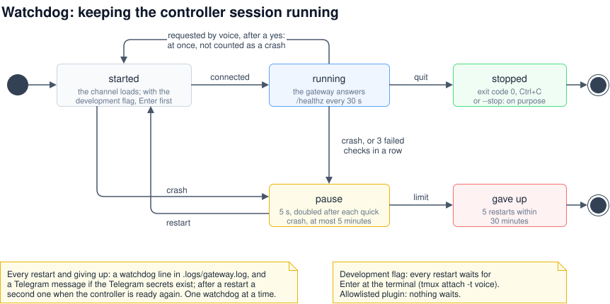

| Behaviour | Default | Setting |
|---|---|---|
| Exit code 0 or 130 (you quit, Ctrl+C) ends the watchdog; any other code or a signal is a crash | – | – |
| Health check of the gateway's `/healthz` | every 30 s | `VOICE_GW_WATCHDOG_INTERVAL` |
| Failed checks in a row (after the gateway answered once) before a restart | 3 | `VOICE_GW_WATCHDOG_HEALTH_FAILS` |
| Pause before a restart, doubled after each quick crash | 5 s, up to 300 s | `VOICE_GW_WATCHDOG_BACKOFF`, `VOICE_GW_WATCHDOG_BACKOFF_MAX` |
| A run this long starts the pause over | 600 s | `VOICE_GW_WATCHDOG_STABLE` |
| Gives up after this many restarts within the window | 5 in 1800 s | `VOICE_GW_WATCHDOG_MAX_RESTARTS`, `VOICE_GW_WATCHDOG_WINDOW` |
| One watchdog at a time | lock in `.state/controller.lock` | – |
| Settings read again before every start, so a restart takes a change; the controller level, `VOICE_GW_SECRETS_DIR`, `VOICE_GW_STATE_DIR`, `VOICE_GW_LOG_FILE` and the watchdog's own settings stay until the start script starts again | – | `.secrets/gateway.env` |
| Log | `watchdog:` lines in `.logs/gateway.log`: who started and who stopped it (the autostart's service or LaunchAgent, or user, process and terminal), and each start's settings with where they came from | – |
| Telegram when a restart begins, a crash or one on purpose, and when it gives up; the gateway sends another when the controller is ready again | if the two Telegram files exist | – |
| macOS: no idle sleep while it runs (`caffeinate -i -s`, ended with the watchdog) | on | `VOICE_GW_CAFFEINATE` |

**Telegram.** One message when a restart begins, one when it is ready:

| Restart | When it begins | When it is ready (from the gateway) |
|---|---|---|
| A crash, or a gateway that stopped answering | "the controller session crashed (exit code 1) and starts again in 5 s, without a confirmation. A message follows when it is ready." | "the controller is ready again, after a crash (exit code 1)." |
| By voice, `restart_controller` ([8.3](#83-restarting-the-controller-by-voice)) | "the controller restarts now (requested by voice). A message follows when it is ready." | "… after a restart requested by voice." |
| The autostart's service, `systemctl --user restart cc-voice-gateway` | "the controller restarts now (a restart of the service cc-voice-gateway.service). A message follows when it is ready." | "… after a restart of the service cc-voice-gateway.service." |

Each starts with "cc-voice-gateway on <host>:". A crash gets only its own message, no second one.
The service's restart runs `start-controller.sh --stop` as systemd's `ExecStop` with the job
`restart` (`systemctl --user list-jobs`): that `--stop` sends the message and leaves the reason in
`.state/controller.restarting` for the watchdog systemd starts next, which hands it to its gateway
for the ready message. A plain `systemctl --user stop`, a start, a boot and the LaunchAgent on macOS
send nothing.

With the development flag, a restarted session waits for the channel warning to be answered at the
terminal (`tmux attach -t voice`, Enter); with the plugin it does not. Claude in Chrome's notice for
the first start would wait there too, at a start by the watchdog or the autostart alike; the start
script marks it as seen beforehand ([8.1](#81-starting-and-stopping)). The message when a restart
begins names what it may wait for: "Confirm the development channel at the terminal (tmux attach -t
voice), otherwise voice requests do not arrive." instead of "without a confirmation", and, when the
last start could not mark Claude in Chrome's notice as seen, "Claude in Chrome's notice for the first
start may wait for Enter at the terminal (tmux attach -t voice)."

### 8.3 Restarting the controller by voice

"Restart the controller":

1. **The controller explains and asks.** It asks `restart_controller` what a restart would do and
   tells you, then asks: which worker runs are going, what happens to open requests, whether
   someone has to confirm at the terminal.
2. **Only after your yes** it calls `restart_controller` with `confirm`.
3. **The restart.** The gateway leaves a note for the watchdog and ends the session. The watchdog
   says on Telegram that the restart begins ("the controller restarts now (requested by voice)"),
   starts it again at once, without a pause, and does not count it as a crash.
4. **Ready message.** A Telegram message says when the controller is ready again, if Telegram is
   set up ([8.2](#82-the-watchdog)).

What survives:

- **Worker runs:** detached; the new gateway follows them and reports their results.
- **Queued tasks:** in `.state/workers.json`; the new gateway starts them in their order.
- **Open decisions:** in `.state/jobs.json`, with your answers.
- **Requests:** kept in `.state/requests.json`. Answers given before the restart stay deliverable.
  An unfinished request ends with a note to say it again; a question to you stays open, and you
  can still answer it. A worker result the old controller had not answered goes to the new one
  again.
- **What is open, for the new session:** once it is connected, the gateway sends it one event with
  `kind="summary"`: open decisions, queued tasks, runs going, requests not finished, and the
  requests the restart ended. The controller works from it instead of memory files. Its reply to
  it is for the gateway only: no news, no Telegram.
- **Not:** open approvals, and the old session's conversation.

Without the watchdog the controller says it cannot restart itself.

### 8.4 Voice commands

Start with "Ask Claude Code …" or "Tell Claude Code …"; within a conversation, follow-ups usually
go there without it. Any language works: the controller answers in the language of the request, in
at most three short sentences, without code, paths or lists.

| You say | What happens |
|---|---|
| "Ask Claude Code whether the gateway is up." | `ask`; an answer within seconds |
| "Tell Claude Code to wait 90 seconds and then let me know." | `send`, then `get_reply` every 25 to 40 s; interim status, then the result |
| "What is Claude Code working on?" | `status`: open requests, approvals, when the controller last answered |
| "Allow." / "Deny." | `approve` with the five-letter code |
| "Which repositories can you work in?" | `list_workers`: branch, uncommitted changes, what each worker does; in Docker the level |
| "Ask the alpha worker whether the tests pass." | `dispatch`; the controller confirms, the result follows as news |
| "Tell the alpha worker to fix the typo in the README." | The worker commits on a `voice/` branch, pushes and opens a pull request (in Docker: depends on the level); you hear that it is out |
| "Open it as a draft." / "Ja" to "Es folgt noch die Übersetzung, als Draft öffnen?" | `dispatch` with `draft`: that one pull request opens as a draft. The controller asks only when more tasks for the same pull request are queued or named; the last of them marks it ready |
| "Tell it to add a test for that too." | A follow-up in the same worker session, on the same branch |
| "Then also update the changelog in alpha." (while alpha works) | `dispatch=queued`: it starts by itself after the run, and you hear its result. With several runs per repository, the controller lets it run next to the other in a worktree of its own when it needs nothing from it, and says so: "It runs in parallel to the test fix." |
| "Stop the second alpha run." / "Stop it for good." | `stop_worker` with that task; a run in a worktree goes back to the queue and resumes, unless you say to stop it for good |
| "What is the alpha worker doing?" | `worker_status`, with the queue there |
| "Stop the alpha worker." | `stop_worker`; the next queued task there starts |
| "Forget the changelog task." / "Stop alpha and drop the rest." | `stop_worker` with `drop` and the task's id, or with `"all"` |
| "What is open?" / "Is anything waiting for me?" | `open_items`: open decisions, queued tasks, runs, unfinished requests; the controller answers from it |
| "Leave the commits in alpha as they are." | `resolve_decision` with your words closes the push decision; alpha's queued tasks go on |
| "Clone drawio-mcp from alderg." | Above `confined`: `clone_repo`; you hear when it is there |
| "Delete the folder old-experiment." | Above `confined`: `delete_path` says what would be lost, the controller asks; you say yes, then confirm the approval |
| "Look up the release notes of the latest Claude Code." | Only at `unrestricted`: the controller uses the web itself. With [work folders](#work-folders) on, at every level: a run in a new work folder looks it up |
| "Rechne mir die Fahrtkosten nach Basel aus." / "Draft a reply to the landlord." | With work folders on: `dispatch` with `scratch/new`; you hear the result, and the files are in that folder at the desk. "Make it shorter." goes to the same folder |
| "Is anyone reviewing pull request 12 in alpha?" / "Did the last CI run on main pass?" | The controller answers itself with read-only `gh` |
| "Request a review for pull request 12 in alpha." | Only on your word: the worker reviews the diff and posts a review, or adds the person you name as reviewer |
| "Fix the review comments on pull request 12." | Only on your word: the worker fixes them, runs the tests, pushes to the same branch, replies on each thread, and says what is left open |
| "Merge pull request 12 in alpha." | The controller asks back with the title and the method; after your yes, `gh pr merge` raises an approval; you confirm a second time |
| "Push it straight to main." | Only in Docker at level `full`: `dispatch` with `direct`. Otherwise the controller says why it stays a pull request |
| "Emergency stop!" | The kill switch locks before anything reaches the controller ([5.9](#59-the-kill-switch)) |
| "Restart the controller." | Restart through the watchdog after your yes ([8.3](#83-restarting-the-controller-by-voice)) |

**Work folders by voice**, once they are turned on ([work folders](#work-folders)), for a task
that needs no repository:

- **Start one** by saying the task without naming a repository: "Rechne mir die Fahrtkosten nach
  Basel aus." or "Draft a reply to the landlord." The controller sends what needs no repository to
  a new work folder and tells you it is on its way. To be sure, say so: "In a new work folder:
  compare the three phone plans." or "Neuer Arbeitsordner: …". At `unrestricted` that is how you
  get a run instead of the controller answering itself.
- **Follow up** in the same conversation: "Make it shorter." or "Und jetzt als Tabelle." continues
  in the same folder and Claude session. Later, name its topic, "the folder with the travel costs":
  the controller looks among the last work folders with `worker_status`. Something new, or "a new
  work folder", gets a folder of its own.
- **While it runs:** "What is the work folder doing?" and "Stop the work folder." work as for a
  repository. When every run slot is taken, it waits in the queue.
- **The result** comes as news: what the files hold, not where. At the desk they are in
  `~/voice-scratch/<date>-<id>` (`VOICE_GW_SCRATCH_ROOT`), for 60 days after the last run
  (`VOICE_GW_SCRATCH_DAYS`, `0` for good); copy out what you want to keep. There is no git, so no branch, no pull
  request and no question about pushing.

**Your words.** The controller passes your words with every dispatch. If they are not from a voice
request of the last `VOICE_GW_DISPATCH_WINDOW` minutes, the gateway starts nothing and the
controller asks you first ([5.4](#54-approvals-by-voice)). When a worker result or a review asks
for something, the controller is told to tell you and let you decide.

**Open items** (`src/ledger.mjs`), so that nothing is forgotten while you drive:

- **Every question is an open decision,** kept in `.state/jobs.json`: the controller's questions,
  of kind `push`, `merge`, `restart`, `delete` or `other`, and what the gateway raises itself: a
  push decision after a run that left commits on no remote or uncommitted files
  ([5.5](#55-workers-on-this-computer-or-in-docker)) or a stop, one for a queued task that could
  not start or that the kill switch took out of the queue, and one for the gateway's own checkout.
- **Pending, asked, answered, closed.** Your answer to the question ("(Answer to <id>) …") is kept
  with it, and a question back on your answer is the same decision. It closes when the follow-up
  dispatch with your answer starts, when the controller replies "done" to your answer (unless that
  follow-up still waits in the queue), or with `resolve_decision` and your words. When you decide
  in a new request instead of answering, the controller closes it with `resolve_decision`.
- **The controller has to ask.** It cannot reply "done" to a request whose decision was never put
  to you; the reply tool says why.
- **The queue waits.** While a decision about a repository is open, its tasks wait
  (`dispatch=queued … reason=decision`); the follow-up for your answer goes first.
- **Reminders.** A decision you were never asked about, or a question you have not answered, comes
  back to the controller after `VOICE_GW_REMIND_MINUTES` (30), at most three times, also one that
  belongs to no request yet; none while the kill switch is locked. It asks you, and you hear it as
  news.
- **What is open?** `open_items` lists everything in one call. At every start of the controller
  session, the gateway sends it the same list as an event, so a restarted controller needs no
  memory files.
- **Texts.** These lists hold what the gateway, the controller and you said; of a worker result
  only its ids. The controller's tasks and questions may quote a worker or a pull request, so the
  summary, reminder and queue events come with `trusted="no"`.

**Pull requests and reviews:**

- **Before a push** that opens a pull request (a push decision, a public repository), the
  controller asks only whether to open it ("Soll ich den PR öffnen?"), without a word about drafts:
  it opens ready for review, and its reviews start at once. A draft only when you say so, or when
  more tasks for the same pull request are queued: then it asks "Es folgt noch X, als Draft
  öffnen?".
- **After a push** you hear only that the pull request is out, and which one. The controller never
  offers a review.
- **The watch.** The gateway takes the pull request URLs in a run's output and checks with `gh`
  that each is open on a `voice/` branch, comes from the repository itself (not a fork), and was
  opened by the account `gh` is logged in as. It watches those: every `VOICE_GW_PR_POLL` seconds
  (60), five times as long after 15 looks. Without a `gh` login it watches nothing. In Docker, a
  pull request opened with the container's token is watched only if that token belongs to the
  same account.
- **Later pushes.** A later run that names the pull request watches it anew, from the start, also
  after the watch stopped, so the reviews and checks that run again reach you. One that pushed to
  it or marked it ready without naming it is caught too: when a run ends, the gateway looks again
  at the last three pull requests it watched for that repository, and one whose head commit or
  draft state changed while the run went counts as the run's.
- **What becomes news:**
  - finished checks, once per push;
  - new reviews and comments, except those of the account `gh` is logged in as;
  - their text only from the repository's owner, members and collaborators. Of anyone else, which
    as a rule includes bots such as Copilot, you hear who reviewed or commented, not what;
  - you hear them as a sentence or two. The controller gets them marked `trusted="no"`.
- **When the watch stops:**
  - nothing shows up in the first five looks;
  - the pull request is merged or closed;
  - after `VOICE_GW_PR_WATCH_HOURS` (24); a later push starts it again (above).

A worker's checkout must not be used at the desk while it runs there: workers switch branches in
your checkouts. A worker never commits, stashes or discards changes it did not make.

### 8.5 Connections and testing at the desk

```bash
node scripts/pair.mjs                # pairing code for the sign-in page
node scripts/pair.mjs list           # connected clients and when they last called
node scripts/pair.mjs revoke <id>    # disconnect one; "revoke all" disconnects every client
node scripts/fake-voice.mjs          # play the voice AI against the local gateway
npm test                             # both ends without Claude Code or a phone
```

`pair.mjs` and `fake-voice.mjs` talk to the running gateway, so the controller must run. A
connector unused for more than 30 days must sign in again. `.logs/gateway.log` has one line per
connector call and sign-in step, and one per HTTP request with the caller's address
(`http 160.79.106.3 funnel POST /mcp 200`); it shows whether and how far the voice AI got, and who
else knocked.

### 8.6 Getting changes out of the container

See [4.5](#45-pushing-from-a-read-only-container). At levels `pr` and `full` the container pushes
by itself; the clean clone still works for trying a branch here first.

### 8.7 Configuration

Settings come from the environment, then from `.secrets/gateway.env`. Claude Code starts the
gateway, so environment variables for it go into the `env` block of `controller/.mcp.json`. The
gateway reads them at its start: restart the controller after a change. Under the watchdog, every
start reads `.secrets/gateway.env` again, and the log line `watchdog: settings from …` shows each
setting with where it came from.

**The worker limits apply at once.** The gateway watches `.secrets/gateway.env` (`src/live.mjs`).
Once a change has settled for a second or two, it reads the file again and applies
`VOICE_GW_MAX_WORKERS` and `VOICE_GW_MAX_WORKERS_PER_REPO` without a restart, as it would at a
start: raised per repository, the controller hears which queued tasks could now run next to
others; lowered, runs going run to the end and nothing new starts above the limit. Every other
changed setting is logged as counting from the next start. A value set in the environment from
outside still wins over the file, and the log says so; one the watchdog's start script exported
from the file does not, as it lists those names in `VOICE_GW_SETTINGS_FROM_FILE`
(`scripts/settings.sh`). Without that list, when Claude Code or you start the gateway yourself, a
value in the environment that equals the file's at the start counts as the file's. A file that cannot be read, is gone or looks half written
(its last line without an end) keeps the limits as they are; a value that is no whole number from
1 to 100 is ignored, with a log line. The setup assistant says when a running gateway takes its
limits at once.

**Gateway** (`src/config.mjs`):

| Variable | Default | Meaning |
|---|---|---|
| `VOICE_GW_PORT` | `8787` | Local HTTP port |
| `VOICE_GW_HOST` | `127.0.0.1` | Bind address; keep loopback |
| `VOICE_GW_SECRETS_DIR` | `.secrets` | Secrets, settings file, admin socket |
| `VOICE_GW_STATE_DIR` | `.state` | Worker state and queue, run output, requests, open decisions, pull request watches |
| `VOICE_GW_SELF_CHECKOUT` | This checkout | The checkout whose uncommitted changes and commits on no remote a "done" reply mentions ([5.5](#55-workers-on-this-computer-or-in-docker)); empty: none. Tests use a stand-in |
| `VOICE_GW_REMIND_MINUTES` | `30` | Minutes before a decision you were never asked about, or a question you have not answered, comes back to the controller as a reminder, at most three times ([8.4](#84-voice-commands)) |
| `VOICE_GW_LOG_FILE` | `.logs/gateway.log` | Empty: stderr only |
| `VOICE_GW_LOG_MAX_MB` | `10` | Past this size the log moves to `gateway.log.1`, replacing the one before |
| `VOICE_GW_OAUTH_HOSTS` | `claude.ai,claude.com` | Hosts allowed in redirect addresses and client ID metadata documents |
| `VOICE_GW_MCP_ALLOW` | `160.79.104.0/21`, Anthropic's | Ranges (CIDR) or addresses that may call `/mcp` through the tunnel, comma-separated; `any`: no limit, for a tunnel without `X-Forwarded-For` ([5.2](#52-the-voice-endpoint-and-oauth)) |
| `VOICE_GW_PERMISSION_RELAY` | on | `0`: approvals only at the terminal |
| `VOICE_GW_PERMISSION_TTL` | `900` | Seconds before an open approval leaves the voice view |
| `VOICE_GW_DEFAULT_WAIT` | `25` | Seconds `get_reply` waits by default |
| `VOICE_GW_MAX_WAIT` | `40` | Upper limit for `get_reply` and `ask` |
| `VOICE_GW_HINT_AFTER` | `20` | Seconds without a reaction from the controller before a diagnostic hint |
| `VOICE_GW_WORKER_ROOT` | The folder holding this repository | Every git repository directly in it has a worker |
| `VOICE_GW_WORKER_SELF` | off | `1`: this repository's own checkout is a worker on this computer too |
| `VOICE_GW_CONTROLLER_LEVEL` | `confined` | `clone-delete` or `unrestricted` ([5.3](#53-the-controllers-confinement)); the gateway, the confine hook and the start script read it |
| `VOICE_GW_DISPATCH_WINDOW` | `30` | Minutes a voice request counts for `dispatch`: only words from requests this recent start a run |
| `VOICE_GW_MAX_WORKERS` | `2` | Runs at the same time, in all; every run of a repository counts. Applies at once when the settings file changes, without a restart |
| `VOICE_GW_MAX_WORKERS_PER_REPO` | `1` | Runs at the same time in one repository; further runs work in git worktrees of their own ([several runs per repository](#several-runs-per-repository)). Applies at once when the settings file changes |
| `VOICE_GW_WORKER_TIMEOUT` | `360` | Minutes before a run is stopped; `0`: no time limit |
| `VOICE_GW_WORKER_MODEL` | Claude Code's default | `--model` for every worker run, host and Docker |
| `VOICE_GW_WORKER_EFFORT` | Claude Code's default | `--effort`: `low`, `medium`, `high`, `xhigh`, `max` |
| `VOICE_GW_CLAUDE_BIN` | `claude` | Claude Code for workers (inside the container in Docker mode) |
| `VOICE_GW_GH_BIN` | `gh` | GitHub CLI on this computer |
| `VOICE_GW_PR_DRAFT` | `0` | `1`: workers open their pull requests as drafts; `0`: ready for review |
| `VOICE_GW_SCRATCH` | `0` | `1`: [work folders](#work-folders) for tasks without a repository; any other value counts as `0` |
| `VOICE_GW_SCRATCH_ROOT` | `~/voice-scratch` | Where the work folders are made, on this computer; outside every git repository, this checkout and the repositories folder |
| `VOICE_GW_SCRATCH_DAYS` | `60` | Days after its last run before a work folder is removed, up to 365; `0`: never |
| `VOICE_GW_SCRATCH_DOCKER` | empty | The work folders' container; empty: their runs run on this computer |
| `VOICE_GW_DOCKER_SCRATCH` | `/scratch` | Where that container mounts `VOICE_GW_SCRATCH_ROOT` |
| `VOICE_GW_PR_POLL` | `60` | Seconds between looks at a watched pull request |
| `VOICE_GW_PR_WATCH_HOURS` | `24` | Hours before a watch ends |
| `VOICE_GW_TELEGRAM_AFTER` | `600` | Seconds without a voice call before questions and approvals also go to Telegram ([5.8](#58-the-telegram-fallback)) |
| `VOICE_GW_TELEGRAM_POLL` | `25` | Seconds one poll of the bot for `/stop` waits |
| `VOICE_GW_TELEGRAM_API` | `https://api.telegram.org` | Bot API; tests use a stand-in |
| `VOICE_GW_FUNNEL_IDLE` | `0`, off | Minutes after the last voice call before the gateway turns the Funnel off ([7.3](#73-publishing-the-endpoint)) |
| `VOICE_GW_FUNNEL_SCRIPT` | `scripts/funnel.sh` | What the gateway runs to switch the Funnel; tests use a stand-in |
| `VOICE_GW_DOCKER` | empty | Worker container; empty: workers on this computer |
| `VOICE_GW_DOCKER_REPOS` | `/repos` | The mounted folder inside the container |
| `VOICE_GW_DOCKER_BIN` | `docker` | Docker CLI |
| `VOICE_GW_ACCESS` | empty | `read-only`, `pr` or `full` for every repository; empty: detected |
| `VOICE_GW_GITHUB_API` | `https://api.github.com` | GitHub API for the level check |
| `VOICE_GW_KILLSWITCH` | `auto` | What locks the kill switch ([5.9](#59-the-kill-switch)): `auto`, the rules and the manual triggers; `manual`, only "emergency stop" by voice, `/stop` on Telegram and the controller's `raise_alarm`, while the rules only log what they would have done; `off`, nothing, every trigger is only logged. Another value counts as `auto` |
| `VOICE_GW_KILL_MAX_EDITS` | `500` | Kill switch: file edits in one run |
| `VOICE_GW_KILL_MAX_FILES` | `300` | Kill switch: files changed in one run |
| `VOICE_GW_KILL_MAX_LINES` | `30000` | Kill switch: lines changed in one run |
| `VOICE_GW_KILL_ALLOW_PATHS` | empty | More folders workers may write to, comma-separated |
| `VOICE_GW_KILL_CHECK` | `30` | Seconds between checks of the default branch and, while locked, of the container |
| `VOICE_GW_MCP_JSON` | `controller/.mcp.json` | Plugin mode: where `src/plugin.mjs` reads the env block |
| `VOICE_GW_CHANNEL_SOURCE` | `voice`, or `plugin:voice:voice` as plugin | The channel's `source` in events |

**Start script and channel** (`scripts/start-controller.sh`, `scripts/channel-mode.mjs`):

| Variable | Default | Meaning |
|---|---|---|
| `VOICE_GW_CONTROLLER_MODEL` | Claude Code's default | `--model` for the controller |
| `VOICE_GW_CONTROLLER_EFFORT` | Claude Code's default | `--effort` for the controller |
| `VOICE_GW_CONTROLLER_CHROME` | `0` | `1`: `--chrome` for the controller, so it can use Claude in Chrome: a Chrome with the Claude extension, signed in, open on a desktop of the same user (a remote desktop session that stays when you disconnect works). Before each start the script marks Claude in Chrome's notice for the first start as seen, so that the session does not wait at the terminal ([8.1](#81-starting-and-stopping)); to be sure, confirm it once at the terminal with `claude --chrome` ([7.1](#71-with-the-setup-assistant)) |
| `VOICE_GW_REMOTE_CONTROL` | `0` | `1`: `--remote-control "Voice controller"` for the controller, to follow and steer it at claude.ai/code and in the Claude app ([Remote Control](#remote-control-from-the-claude-app)); not the workers, whose headless runs Remote Control does not connect. Any other value counts as `0`. The gateway reads it too, to say so in its log |
| `VOICE_GW_WATCHDOG` | `1` | `0`: start without the watchdog |
| `VOICE_GW_WATCHDOG_INTERVAL` | `30` | Seconds between health checks |
| `VOICE_GW_WATCHDOG_HEALTH_FAILS` | `3` | Failed checks before a restart |
| `VOICE_GW_WATCHDOG_MAX_RESTARTS` | `5` | Restarts within the window before giving up |
| `VOICE_GW_WATCHDOG_WINDOW` | `1800` | The window, in seconds |
| `VOICE_GW_WATCHDOG_BACKOFF` | `5` | First pause in seconds |
| `VOICE_GW_WATCHDOG_BACKOFF_MAX` | `300` | Longest pause |
| `VOICE_GW_WATCHDOG_STABLE` | `600` | A run this long resets the pause |
| `VOICE_GW_CAFFEINATE` | `1` | macOS: `0` lets the Mac sleep by its energy settings while the watchdog runs |
| `VOICE_GW_CHANNEL` | chosen | `plugin` or `development` |
| `VOICE_GW_MANAGED_SETTINGS` | `/etc/claude-code/managed-settings.json`, on macOS `/Library/Application Support/ClaudeCode/managed-settings.json` | Managed settings file on this computer |
| `CLAUDE_CONFIG_DIR` | `~/.claude` | Where Claude Code keeps `remote-settings.json` and the marketplaces |

The start script exports `VOICE_GW_CHANNEL_MODE`, `VOICE_GW_WATCHDOG_LOCK` and
`VOICE_GW_SETTINGS_FROM_FILE` (the names it took from the settings file at that start) for the
gateway; do not set them.

**Container and fetch helper** (`scripts/start-workers-container.sh`,
`scripts/fetch-from-container.sh`, `docker/`):

| Variable | Default | Meaning |
|---|---|---|
| `VOICE_GW_DOCKER` | `voice-workers` | The container |
| `VOICE_GW_DOCKER_FOLDER` | `~/docker-developer` | Host folder mounted at `/repos` |
| `VOICE_GW_SCRATCH_DOCKER` | `voice-scratch` | With `--scratch`: the work folders' container |
| `VOICE_GW_SCRATCH_ROOT` | `~/voice-scratch` | With `--scratch`: the host folder mounted at `/scratch`, made if missing |
| `VOICE_GW_DOCKER_IMAGE` | `cc-voice-worker` | Image, for both containers |
| `VOICE_GW_DOCKER_REPOS` | `/repos` | Path inside the container |
| `VOICE_CLEAN_ROOT` | The folder holding this repository | Where the clean clones are |
| `VOICE_SECRETS` | `/run/secrets/voice` | Inside the container: where `voice-run` and the credential helper read the tokens |

**Setup assistant and Funnel** (`scripts/setup.mjs`, `scripts/funnel.sh`):

| Variable | Default | Meaning |
|---|---|---|
| `VOICE_SETUP_HOST` | `0.0.0.0` | Bind address |
| `VOICE_SETUP_PORT` | `8790` | Port |
| `VOICE_SETUP_TIMEOUT` | `30` | Minutes at most |
| `VOICE_SETUP_IDLE` | `10` | Minutes without activity |
| `VOICE_SETUP_GIT_BIN`, `VOICE_SETUP_TMUX_BIN`, `VOICE_SETUP_SYSTEMCTL_BIN`, `VOICE_SETUP_LOGINCTL_BIN`, `VOICE_SETUP_LAUNCHCTL_BIN`, `VOICE_SETUP_PLUTIL_BIN`, `VOICE_SETUP_TAILSCALE_BIN` | `git`, `tmux`, `systemctl`, `loginctl`, `launchctl`, `plutil`, `tailscale` | Commands the assistant runs; tests use stand-ins. On macOS it also looks in Homebrew's folders, and for Tailscale in the app |
| `VOICE_GW_TAILSCALE_BIN` | `tailscale`, on macOS else the Tailscale app's | The tailscale command `scripts/funnel.sh` runs |
| `FUNNEL_PORT` | `443` | Public port of the Funnel |

### 8.8 Troubleshooting

| Symptom | Cause and fix |
|---|---|
| Connector dialog says no server answered, and nothing is in the log | The public address is not on port 443, or it was only just set up. Tailscale Funnel needs a few minutes on the first start; `scripts/funnel.sh start` reports when all relays answer. |
| Sign-in goes to an `http://` address or to the wrong host | The tunnel or proxy does not pass the public host name or `X-Forwarded-Proto: https` (see [Publishing the endpoint](#73-publishing-the-endpoint)). |
| Sign-in page says the app is not registered | The sign-in state was reset, for example because `.secrets/oauth.json` was deleted. Remove the connector and add it again. |
| Sign-in fails with Claude's published identity | Choose to register automatically instead. If the log shows `client id document not allowed: <URL>`, that host is missing from `VOICE_GW_OAUTH_HOSTS`. |
| "Wrong or expired code" | Run `node scripts/pair.mjs` again. A code lasts five minutes and one sign-in. Five wrong attempts from one browser or address, or twenty in all, burn it. |
| `pair.mjs` says the gateway is not running | Start the controller; the gateway runs inside its session. |
| The connector stopped working after weeks unused | The refresh token expired after 30 days. Sign in again from the connector's settings. |
| Claude asks before every tool call | Choose "Always allow" for the connector's tools. |
| Startup warning that channels are not enabled for the organisation | Team and Enterprise, including a Max seat in a Team organisation: an Owner enables Organization settings → Claude Code → Channels. `claude --debug` logs "the organization is team" in that case. |
| Channel event arrives, but no answer | The controller's turn failed, for example "Login expired". Look at the controller terminal; `/login` there. |
| `status` reports `controller=unconfirmed`, `get_reply` shows a hint | The session runs without the channel (neither the plugin nor `--dangerously-load-development-channels server:voice`), or the organisation blocks channels. Start it with `scripts/start-controller.sh` and check `/mcp`; otherwise Claude Code drops events silently. |
| `voice port … is in use by another process` in the log, and the same on Telegram | Another process holds `VOICE_GW_PORT`: a second controller session, or a gateway left over from an earlier session, which also answers the watchdog's `/healthz`. The new gateway ends with an error. `lsof -nP -iTCP:8787 -sTCP:LISTEN` shows the process; end it, start only one controller, then restart it. |
| Voice assistant answers itself instead of asking | Say "Ask Claude Code …" explicitly. |
| Voice assistant says the connector does not work | Look at `.logs/gateway.log`. No `voice initialize`: the request never arrived (URL, tunnel or proxy, DNS). `voice 401`: the client has to sign in again. `voice 403`: the caller's address is not allowed, see the next row. `initialize` and `tools/list` but no `tools/call`: the assistant chose not to call a tool. |
| `voice 403 … not an allowed address` for Claude's own calls | Anthropic calls from a range missing in `VOICE_GW_MCP_ALLOW`, or the tunnel does not put the caller's address last in `X-Forwarded-For` (then every call shows the same address). Add the range, or set `VOICE_GW_MCP_ALLOW=any`, and restart the controller. |
| A Telegram alert about a request without a token, or a sign-in | It names the address. A request without a token from Anthropic's addresses comes with every new sign-in of the connector; if you did not connect it, nothing got in, and the pairing code keeps it so. A successful sign-in you did not make: `node scripts/pair.mjs list`, then `revoke`. |
| A repository is missing from `list_workers` | Only folders directly in the worker root with a `.git` count. Check `VOICE_GW_WORKER_ROOT`. |
| `work folders off: …` in the log, and no `scratch/new` in `list_workers` | `VOICE_GW_SCRATCH=1` is set, but the root is inside a git repository, this checkout or the repositories folder, or is the home folder (a home folder that is itself a git repository counts too), or `VOICE_GW_SCRATCH_DOCKER` names the workers' container. Choose another `VOICE_GW_SCRATCH_ROOT` or container, then restart the controller. |
| `No work folder "scratch/…"` | It was removed `VOICE_GW_SCRATCH_DAYS` after its last run. Its files are gone with it; a new task starts with `scratch/new`. |
| The kill switch locked on a run in a work folder | Such a run may write only in its folder, the temporary folders and its memory folder; a file in the home folder or in `VOICE_GW_KILL_ALLOW_PATHS` is enough. Read the reason; the worker's rules ask it to keep everything in its folder. |
| `The container voice-scratch does not answer` or `could not make …` | The work folders' container is stopped or was removed: `scripts/start-workers-container.sh --scratch`. |
| The controller says it cannot clone or delete | The level is `confined`, or workers run in Docker; the log line `controller level …` says which. A new level counts from the next start of the start script: `--stop`, then start it again. |
| `delete=unplanned` | A deletion needs a plan of the same path from the last 15 minutes: the controller calls `delete_path` without `confirm` first. |
| A worker fails at once | `could not start claude`: Claude Code is not on the gateway's `PATH`; set `VOICE_GW_CLAUDE_BIN`. Otherwise read `.state/tasks/<task>.err`. |
| A queued task does not start | It waits while a run goes on in its repository (or as many as `VOICE_GW_MAX_WORKERS_PER_REPO` allows, or one it waits for with `after`), while that run's result has not reached the controller (is the session connected?), while every `VOICE_GW_MAX_WORKERS` slot is taken, and while the kill switch is locked; behind a worker container that does not answer it tries again every 30 s. `list_workers` shows the queue, `.state/workers.json` holds it under `queue`. |
| A worktree stays in `.voice-worktrees` | Something in it is not committed or not pushed, a queued task resumes there, or a decision refers to it: `worker_status` names it. Push or drop the work there at the desk (`git worktree remove`), or have the run finished with `dispatch` and `continues`. |
| An event with `kind="queue"` | A queued task could not start at its turn and left the queue: uncommitted changes, the origin changed in the container, a `direct` push not allowed, or the repository is gone. It is an open decision now; the controller asks you, and dispatched again, it starts from the beginning. |
| `dispatch=queued … reason=decision`, and nothing starts | An open decision about the repository holds its tasks, for example unpushed commits after the last run. Answer it, or tell the controller to leave it: `resolve_decision` closes it with your words, and the tasks start. `open_items` lists what holds what. |
| The controller says a reply was "Not sent: decision … was never asked" | The gateway raised a decision on that request, and the controller has to put it to you before it may reply "done". It is meant to ask with state "question"; nothing is lost in between. |
| A decision stays open although it was settled | It closes by itself only through the follow-up dispatch for your answer or the controller's "done" to it. Say what you decided; the controller closes it with `resolve_decision`. `.state/jobs.json` holds them all. |
| A result says `git="1 commit on no remote"` although the worker pushed | The check counts commits that no remote-tracking branch (`refs/remotes/…`) has. A push to a URL instead of a named remote does not update them; `git fetch` in the checkout does. Without any remote, commits never count. |
| What did a worker do? | `.state/tasks/<task>.jsonl` holds the whole run. `claude --resume <session>` in the repository opens the session; `.state/workers.json` lists the session ids. |
| A private repository is handled like a public one | `gh` is not logged in or not on the `PATH`, so the visibility is unknown, and the worker asks before pushing to be safe. |
| No news about checks or reviews on a worker's pull request | The log says why: `gh is not logged in`, or `stopped watching pull request … : nothing automatic runs` (often a draft that bot reviewers skip, with `VOICE_GW_PR_DRAFT=1` or `draft`; marking it ready in a later run watches it again), `merged`, `closed` or `time limit`. Only pull requests on `voice/` branches that a run linked to, or pushed to after that, are watched. `.state/pulls.json` lists the watches. |
| The controller cannot merge a pull request | A draft must be marked ready first (a task for the worker). Required reviews or checks, conflicts and other branch protection apply; `--admin` is blocked on purpose. With `VOICE_GW_PERMISSION_RELAY=0` the approval only appears at the terminal. |
| The controller says a `gh` command was blocked | Only the commands in [The controller's confinement](#53-the-controllers-confinement) pass, each with `--repo owner/name` and flags as separate words. If it does not know about `gh` at all, restart the controller so that it reads the current `controller/CLAUDE.md`. |
| The controller says a tool is blocked | Expected for every tool that is not on the confine hook's list ([confinement](#53-the-controllers-confinement)): MCP tools from your settings or plugins, subagents, skills, web access. Ask for it at the desk, or let a worker do it with `dispatch`. |
| The controller says one of its own voice tools is blocked | The gateway has a tool that the hook does not know. Add its name to `GATEWAY_TOOLS` in `controller/.claude/hooks/confine.mjs` and to the allow rules in `controller/.claude/settings.json`, then restart the controller. |
| The controller cannot write `CLAUDE.md`, `AGENTS.md`, `.mcp.json` or into a `.claude` folder | Expected, also in `playground/`: Claude Code would read them as instructions or settings. Choose another name. |
| With the development flag, Claude Code refuses `--mcp-config` or `--strict-mcp-config` at the start | Your organisation's managed settings forbid it. `disableSideloadFlags`: use the plugin instead ([Admin steps](#74-admin-steps-for-team-and-enterprise)). "An enterprise MCP config is present": the organisation's `managed-mcp.json` decides which MCP servers run; ask its admin. |
| The setup link says it is not valid or already used | The link works once, in one browser. Go on in that browser, or start `node scripts/setup.mjs` again for a new link. |
| The setup page says "Too many wrong links" | Five wrong links from one address within ten minutes, or 30 in total, block every attempt for a while. Wait, or start the assistant again. |
| The setup assistant does not start | `needs a terminal`: it shows its link only on a terminal, so run it directly, not with its output redirected. `cannot listen on …: EADDRINUSE`: choose another `--port`. |
| The setup page cannot be reached from another computer | A firewall blocks the port, or `--host` names one address only. Or use the SSH tunnel the terminal shows. |
| "Find my chat" finds nothing | Write to the bot after checking the token; Telegram keeps messages for 24 hours. A running gateway that polls the same bot takes them away: quit the controller first. |
| No Telegram message | Questions and approvals go out only after `VOICE_GW_TELEGRAM_AFTER` seconds (600) without a voice call, and only if the voice assistant has not picked them up. Results never go to Telegram. `telegram fallback off` in the log: a file was missing or empty when the gateway started; fix it and restart the controller. `telegram send failed: 400 Bad Request: chat not found`: wrong chat ID, or you never wrote to the bot. `401 Unauthorized`: wrong token. |
| `The worker container voice-workers does not answer` | The container is stopped or was removed: `docker start voice-workers`, or `scripts/start-workers-container.sh`. |
| `access read-only (no GitHub token)` although there is one | It must be `.secrets/worker/github_token`, readable for the gateway. A new token counts at the next check, within ten minutes. |
| `access read-only (the token cannot see the repository (404))` | The token's repository access does not include it, or the organisation has not approved the token yet. |
| `access full` where you expected `pr` | No ruleset or branch protection requires pull requests on the default branch, or the private repository's plan has none. Protect it, or set `VOICE_GW_ACCESS=pr`. |
| `worker container …: /repos is a volume, not a host folder` or `… it runs as …` | The container was started without `-v <folder>:/repos` or without `--user "$(id -u):$(id -g)"`. Remove it (`docker rm -f voice-workers`) and start it with `scripts/start-workers-container.sh`. |
| `fetch-from-container: the container could not bundle …` | The branch does not exist in the container's repository, or the container is not running. The worker names its branch at the end of each run. |
| A worker in Docker fails at once | Claude Code is not logged in: `.secrets/worker/claude_token` is missing or expired; run `claude setup-token` again. Otherwise read `.state/tasks/<task>.err`. |
| `dispatch=locked`, `[state=locked]` or an `[ALARM]` line | The kill switch is locked; the alarm names the trigger. `node scripts/unlock.mjs --status` shows it, `node scripts/unlock.mjs` at the server unlocks it. |
| `dispatch=origin` | In the container, the repository's `origin` is no longer the GitHub repository the gateway saw first ([5.6](#56-access-levels-and-their-detection)). Check the clone at the desk; if the change is wanted, stop the controller and remove the repository's line under `origins` in `.state/workers.json`. |
| The kill switch locked for no good reason | Read the reason. A rule that misfires: raise its `VOICE_GW_KILL_*` threshold, or add a folder to `VOICE_GW_KILL_ALLOW_PATHS`. |
| `/stop` on Telegram does nothing | Only your configured private chat counts, and the gateway must poll the bot: the log says `telegram commands: …` if a webhook or another program takes the updates. |
| `/funnel on` answers "Ignored …: it was sent … ago" | The gateway was not running when you sent it, for example during a restart or right after boot. Send it again. |
| `/funnel on` answers "The Funnel did not come on: Access denied" | Run `sudo tailscale set --operator=$USER` once on the computer. |
| The Funnel goes off while you still use voice mode | It goes off `VOICE_GW_FUNNEL_IDLE` minutes after the last voice call; a long silence counts. Raise the minutes, or send "keep alive". |
| No approval by voice | Expected for Bash, Write and Edit: they run without asking. For other tools: the session runs in auto or bypass mode, an allow rule covers the tool, or it is a trust or consent dialog, which is not relayed. Start the session with `scripts/start-controller.sh`. |
| The controller still starts with the development flag after the admin step | The log line `channel: the development flag, since …` says why. The script reads Claude Code's local copy of the managed settings (`~/.claude/remote-settings.json`), which Claude Code updates when a session starts, so the first start after the admin step still sees the old copy: answer the warning or quit, and start again. `node scripts/channel-mode.mjs` shows what the next start will use; `claude doctor` shows whether the managed settings arrived. |
| With `VOICE_GW_REMOTE_CONTROL=1`, "Voice controller" is missing in the Claude app | It counts from the next start of the session; the log line `watchdog: remote control: …` shows that it was passed. The controller's terminal (`tmux attach -t voice`) shows why it did not connect, and `claude doctor` which check failed: Claude Code signed in with an API key or a token instead of claude.ai, `CLAUDE_CODE_DISABLE_NONESSENTIAL_TRAFFIC` or `DISABLE_GROWTHBOOK` set, or on Team and Enterprise Remote Control not turned on by an Owner ([7.4](#74-admin-steps-for-team-and-enterprise)). After a restart, take the newest session of that name. |
| No worker shows up in the Claude app | Expected: only the controller connects. Worker runs are headless (`claude -p`), which Remote Control does not connect ([Remote Control](#remote-control-from-the-claude-app)); ask the controller what a worker does, or read `.state/tasks/<task>.jsonl`. |
| "Restart the controller" and the controller says it cannot restart itself | It was not started by `scripts/start-controller.sh` with the watchdog. Restart it at the computer. |
| Voice requests stop arriving after a crash | The watchdog started the session again, and the development-channel warning waits: `tmux attach -t voice`, then Enter. `grep watchdog .logs/gateway.log` shows what happened. |
| After a start with `VOICE_GW_CONTROLLER_CHROME=1` the controller does not come up, and its terminal shows "Claude in Chrome" with "Enter to confirm · Esc to cancel" | Claude in Chrome's notice for the first start; Enter or Esc goes on (`tmux attach -t voice`), and Claude Code does not show it again. The start script marks it as seen beforehand; the log line `watchdog: chrome: …` says why it could not. |
| `the controller is already running (watchdog …)` | A watchdog runs already, for example in another tmux window. `scripts/start-controller.sh --status`; `--stop` ends it. |
| `watchdog: giving up …` | The session kept crashing, for example because the login expired. Look at the controller terminal, fix the cause, and start it again. |
| After a reboot the controller runs only while you are logged in, and stops when your SSH session ends | Lingering is off for your user: `loginctl enable-linger`, or `sudo loginctl enable-linger $USER` if that is refused. The setup assistant turns it on with the autostart. |
| macOS: after a restart of the Mac the controller does not run | LaunchAgents start at a login. Log in, or turn on automatic login (System Settings, Users & Groups; not with FileVault). `launchctl print gui/$(id -u)/com.drawio.cc-voice-gateway` shows whether it is loaded. |
| macOS: the LaunchAgent does not start the controller | `~/Library/Logs/cc-voice-gateway.log` has tmux's message: `duplicate session: voice` means it runs already. `scripts/check-macos.sh` checks the plist, its tmux and whether its `PATH` finds node, claude, git and gh; run the setup again from a Terminal that finds them. |
| macOS: `launchctl bootstrap` says `Bootstrap failed: 5: Input/output error` | It is loaded already: `launchctl bootout gui/$(id -u)/com.drawio.cc-voice-gateway` first, or `launchctl kickstart` to start it. Or the plist is invalid: `plutil -lint` says where. |
| macOS: voice requests stop while nobody uses the Mac | The Mac sleeps. The watchdog's `caffeinate` prevents idle sleep (log line `caffeinate: …`, `pmset -g assertions`), not a closed lid without an external display; check that `VOICE_GW_CAFFEINATE` is not `0`. |
| A start script fails at once with `mapfile: command not found` or another bash error on macOS | A checkout from before macOS support: pull. Since then the scripts run with bash 3.2; `scripts/check-macos.sh` runs `bash -n` on each with `/bin/bash`. |

Claude Code's debug log is at `~/.claude/debug/<session-id>.txt`.

## 9. Repository layout

```text
src/
  gateway.mjs        entry point: wires both sides, exits with the session
  channel.mjs        stdio side: channel, reply and worker tools, permission relay
  voice.mjs          HTTP side: the voice tools
  oauth.mjs          sign-in: OAuth metadata, registration, pairing page, tokens
  ipguard.mjs        the door: access log, /mcp only from Anthropic's addresses, alerts on Telegram
  workers.mjs        workers: repositories, claude -p runs, the queue, the check after a run, results
  workspaces.mjs     where a run works: a repository, or a work folder, with its rules and check
  worktrees.mjs      the worktrees of further runs of a repository: made, with submodules, removed
  live.mjs           the worker limits from the settings file while the gateway runs
  ledger.mjs         open decisions for the driver, and the open items
  runners.mjs        where workers run: this computer, or the Docker container; a run's processes
  access.mjs         access levels in the container, from the GitHub token
  pulls.mjs          the watch on pull requests that workers open
  telegram.mjs       Telegram fallback, and /stop and /funnel from your chat
  funnel.mjs         the Funnel on and off from Telegram, and off by itself when idle
  killswitch.mjs     the kill switch: state, emergency phrases, alarm
  guard.mjs          the kill switch's rules on the workers' runs
  restart.mjs        restarting the controller by voice, through the watchdog
  plugin.mjs         the gateway as the MCP server of the plugin voice@cc-voice-gateway
  store.mjs          requests and approvals, persisted across restarts
  folders.mjs        cloning and deleting in the worker root, above the level confined
  admin.mjs          Unix socket for pair.mjs, unlock.mjs and fake-voice
  config.mjs         settings from the environment and .secrets/gateway.env
  settings.mjs       reads and writes .secrets/gateway.env
  platform.mjs       what differs on macOS: temporary folders, the autostart's PATH and names
  setup/             the setup assistant: server.mjs (guard), actions.mjs (steps), ui/ (page)
  http.mjs, log.mjs  small HTTP helpers; log to stderr and file, never stdout
controller/
  .mcp.json          starts the gateway as the server "voice"
  .claude/settings.json        allow and deny rules, the hook
  .claude/hooks/confine.mjs    the controller's confinement
  CLAUDE.md          the controller's instructions
  playground/        the one folder the controller writes to
.claude-plugin/      this repository as the marketplace cc-voice-gateway, with the plugin voice
docker/              Dockerfile, voice-run, voice-stop, git-credential-voice
scripts/
  setup.mjs                    the setup assistant
  start-controller.sh          controller with its channel, under the watchdog
  channel-mode.mjs             plugin or development flag
  controller-settings.mjs      the session's --settings for its level
  chrome-onboarding.mjs        Claude in Chrome's notice for the first start, marked as seen
  settings.sh                  .secrets/gateway.env for the shell scripts
  start-workers-container.sh   the worker container, or with --scratch the work folders'; read-only while locked
  fetch-from-container.sh      a branch from the container into a clean clone, as a bundle
  unlock.mjs                   unlock the kill switch, at the server only
  pair.mjs                     pairing codes, connections
  funnel.sh, check-public.mjs  Tailscale Funnel, and a check through its relays
  telegram-notify.mjs          one Telegram message, for the watchdog
  fake-voice.mjs               play the voice AI at the desk
  check-macos.sh               the checks on a Mac, PASS or FAIL each (docs/macos.md)
test/                one file per area; npm test runs them all, with stand-ins for Claude Code,
                     gh, docker, the GitHub API and Telegram
docs/
  *.drawio.svg       the diagrams, made with draw.io
  index.html         the product page (GitHub Pages, from this folder)
  macos.md           install and test on a Mac, step by step
  assets/            the video, its poster, the README thumbnail, the dark architecture diagram
video/               the video's sources: script.json (voiceover), slides.html (frames), build.mjs
```

## 10. Sources

- [Claude Code: channels][channels], [channels reference][ref], [enterprise controls][channels-admin]
- [Claude Code: Remote Control][rc], [cross-session messaging][csm], [authentication and
  setup-token][auth], [sandboxing][sandbox], [permissions][perm]
- [Claude Help Center: voice mode][voice], [custom connectors][connectors]
- [MCP authorisation][mcpauth], [Tailscale Funnel][funnel]
- [carcode][carcode], [DashVox][dashvox], [VoiceMode][voicemode], [Claude on CarPlay][carplay]
- [talk-to-claude-code][t2cc]: the model for polling and voice-friendly tool results
- GitHub: [fine-grained tokens][pat-fine], [classic tokens][pat-classic],
  [personal access tokens][pat], [rulesets][rulesets]
- Claude Code release notes: [2.1.80][rel-80] (channels), [2.1.81][rel-81] (permission relay),
  [changelog][changelog] (2.1.84: `allowedChannelPlugins`)

[channels]: https://code.claude.com/docs/en/channels
[channels-admin]: https://code.claude.com/docs/en/channels#enterprise-controls
[ref]: https://code.claude.com/docs/en/channels-reference
[rc]: https://code.claude.com/docs/en/remote-control
[csm]: https://code.claude.com/docs/en/cross-session-messaging
[auth]: https://code.claude.com/docs/en/authentication
[perm]: https://code.claude.com/docs/en/permissions
[sandbox]: https://code.claude.com/docs/en/sandboxing
[voice]: https://support.claude.com/en/articles/11101966-use-voice-mode
[connectors]: https://support.claude.com/en/articles/11175166-getting-started-with-custom-connectors-using-remote-mcp
[mcpauth]: https://modelcontextprotocol.io/specification/2025-11-25/basic/authorization
[funnel]: https://tailscale.com/docs/reference/tailscale-cli/funnel
[t2cc]: https://github.com/osaighi/talk-to-claude-code
[carcode]: https://github.com/Harsh-Rastogi-03/carcode
[dashvox]: https://apps.apple.com/app/dashvox/id6762529006
[voicemode]: https://github.com/mbailey/voicemode
[carplay]: https://www.macrumors.com/2026/09/04/anthropics-claude-is-coming-to-carplay/
[pat-fine]: https://github.com/settings/personal-access-tokens/new
[pat-classic]: https://github.com/settings/tokens/new?scopes=repo&description=cc-voice-gateway
[pat]: https://docs.github.com/en/authentication/keeping-your-account-and-data-secure/managing-your-personal-access-tokens
[rulesets]: https://docs.github.com/en/repositories/configuring-branches-and-merges-in-your-repository/managing-rulesets/creating-rulesets-for-a-repository
[rel-80]: https://github.com/anthropics/claude-code/releases/tag/v2.1.80
[rel-81]: https://github.com/anthropics/claude-code/releases/tag/v2.1.81
[changelog]: https://github.com/anthropics/claude-code/blob/main/CHANGELOG.md
